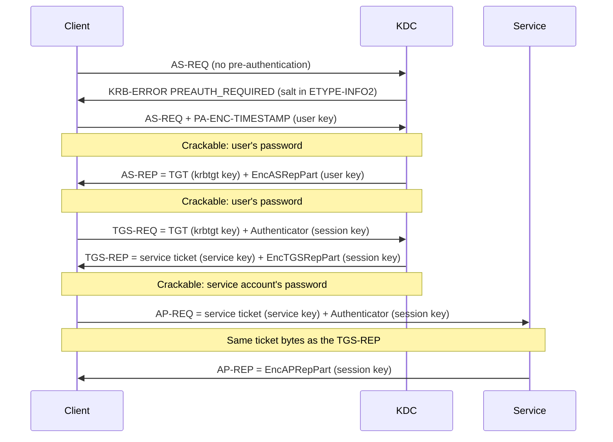

# Crackable Fields

Every encrypted field in Kerberos carries an integrity tag made with the same key that encrypted it: HMAC-SHA1-96 for AES, HMAC-MD5 for RC4 ([RFC 3961 &sect;5.3](https://datatracker.ietf.org/doc/html/rfc3961#section-5.3), [RFC 4757](https://datatracker.ietf.org/doc/html/rfc4757)). When that key comes from a password, anyone who captures the field can test guesses offline: derive a key from each guess and check it against the tag. A match is the password. This needs no known plaintext, and the KDC never sees the guessing, so nothing is logged or locked out.

A full exchange has three fields whose keys come from a password, under two keys:

- **The user's key** encrypts the AS-REQ timestamp and the AS-REP encrypted part. Either one reveals the user's password.
- **The service account's key** encrypts the service ticket. The same ticket appears in the TGS-REP and again in the AP-REQ, byte for byte. This key is a password only when the account is a user account; a computer or managed account has a random password.

Two other long-term keys appear but have random passwords: the `krbtgt` key on the TGT, and (with delegation) a front-end service's key on an extra ticket. Everything else in the exchange uses a session key, which is also random and never comes from a password.

--8<-- "includes/authorized-use.md"

---

## The three crackable fields

These are the only fields in the exchange with a password-based key. The TGS-REP and AP-REQ hold the same ticket, so cracking either one gives the same result.

| | **AS-REQ** | **AS-REP** | **TGS-REP / AP-REQ** |
|---|---|---|---|
| **Field** | PA-ENC-TIMESTAMP | AS-REP encrypted part | Service ticket |
| **Path** | `padata` (type 2) | `enc-part` | `ticket.enc-part` |
| **Key** | User's key | User's key | Service account's key |
| **Reveals** | User's password | User's password | Service account's password |
| **Decrypts to (first byte)** | PA-ENC-TS-ENC (`0x30`) | EncASRepPart (`0x79`) | EncTicketPart (`0x63`) |
| **Inside** | Timestamp | TGS session key, times, `krbtgt/REALM` | Session key, client name, times, [PAC](../../protocol/tickets.md#pac) |
| **AES salt comes from** | ETYPE-INFO2 in the prior error | ETYPE-INFO2 in the error or the AS-REP | Not in the exchange ([why](#the-salt)) |
| **Etype chosen by** | Client's request and the user's keys | Client's request and the user's keys | Service account's settings and keys |
| **Key is a password?** | Yes | Yes | Only for user accounts |
| **Attack** | [AS-REQ Roasting](asreq-roasting.md) | [AS-REP Roasting](asrep-roasting.md) | [Kerberoasting](kerberoasting.md) |
| **Reuse the key with** | [Pass-the-Key](../credential-theft/pass-the-key.md) | [Pass-the-Key](../credential-theft/pass-the-key.md) | [Silver Ticket](../forgery/silver-ticket.md) |

The AS-REQ and AS-REP fields use the same user key (with different [key usage numbers](https://datatracker.ietf.org/doc/html/rfc4120#section-7.5.1), 1 and 3), so cracking one is enough. [Password Spraying](../credential-theft/password-spraying.md) guesses the same password as AS-REQ Roasting, but online against the KDC instead of offline.

In this site's lab, both user fields cracked at AES256 and RC4. The service ticket was not tested, because the lab's only SPNs belong to computer accounts, whose keys are random rather than password-based.

### Hashcat modes

A ticket cracks from its encrypted part alone, so the TGS-REP modes also take a ticket from an AP-REQ or an [S4U2Proxy](#s4u2proxy) request. The NT-hash modes test NT hashes instead of passwords.

| Field | RC4 | RC4 (NT hash) | AES128 | AES256 | DES-MD5 | DES-CRC |
|---|---|---|---|---|---|---|
| PA-ENC-TIMESTAMP | 7500 | 39400 | 19800 | 19900 | 39000 | 39300 |
| AS-REP encrypted part | 18200 | 35400 | 32100 | 32200 | 38600 | 39200 |
| Service ticket | 13100 | 35300 | 19600 | 19700 | 38500 | 39100 |

Modes 39000 to 39400 are on hashcat's master branch, not in the 7.1.2 release.

---

## The full exchange

Active Directory requires pre-authentication by default, so logging on and reaching one service takes eight messages. The first AS-REQ has no pre-authentication; the KDC rejects it with an error that hands back the encryption types and salt to use. The AP-REQ and AP-REP never touch port 88, because they ride inside the application protocol (see [Application Wrapping](../../protocol/ap-exchange.md#application-wrapping)).

Every encrypted field in order, crackable or not:

| Message | Encrypted field | Key | Crackable? | See |
|---|---|---|---|---|
| AS-REQ (first) | nothing encrypted | - | No | [User Enumeration](../credential-theft/user-enumeration.md) reads the reply |
| KRB-ERROR | nothing (ETYPE-INFO2 is cleartext) | - | No, but it carries the user's salt | |
| AS-REQ (with pre-auth) | PA-ENC-TIMESTAMP | User | **Yes** | [AS-REQ Roasting](asreq-roasting.md) |
| AS-REP | TGT | `krbtgt` | No (random) | [Golden Ticket](../forgery/golden-ticket.md) forges it with the key |
| AS-REP | EncASRepPart | User | **Yes** | [AS-REP Roasting](asrep-roasting.md) |
| TGS-REQ | TGT (copy) | `krbtgt` | No (random) | |
| TGS-REQ | Authenticator | Session key | No | |
| TGS-REQ (S4U2Proxy) | extra ticket | Front-end service | **Yes**, if a user account | [Constrained Delegation](../delegation/delegation-attacks.md#constrained) |
| TGS-REP | service ticket | Service account | **Yes**, if a user account | [Kerberoasting](kerberoasting.md) |
| TGS-REP | EncTGSRepPart | Session key | No | |
| AP-REQ | service ticket (copy) | Service account | **Yes**, same bytes | [Kerberoasting](kerberoasting.md), [Silver Ticket](../forgery/silver-ticket.md) |
| AP-REQ | Authenticator | Session key | No | |
| AP-REP | EncAPRepPart | Session key | No | |

With [FAST](../../protocol/preauth.md#fast-kerberos-armoring), each message gets one more encrypted field under the armor key. That key is random too, so it adds nothing to crack.

When you pull these fields from a capture, match on the field path (`ticket.enc-part` versus the outer `enc-part`), not on position. In the lab, FAST armoring pushed the service ticket from the first cipher field to the second.

---

## What each capture point sees

A passive capture gives you different fields depending on which direction of traffic it sees.

| You capture | Messages | Crackable fields | AES salt? |
|---|---|---|---|
| Client to KDC | AS-REQ, TGS-REQ | PA-ENC-TIMESTAMP | No. The salt is only in the KDC's replies. |
| KDC to client | KRB-ERROR, AS-REP, TGS-REP | AS-REP part, service ticket | For the user, yes. For the service, no. |
| Both directions | all port 88 | all three | For the user, yes. For the service, no. |
| Client to service | AP-REQ | service ticket | No |
| Service to client | AP-REP | none | - |

Every logon includes an AS-REP, so a capture of the KDC's replies gives an AS-REP part for every user who logs on, not just accounts with `DONT_REQUIRE_PREAUTH`. That flag matters only when you have to request the AS-REP yourself (see [AS-REP Roasting](asrep-roasting.md)).

Client-to-service traffic gives you the ticket for every service the clients use, with no TGS-REQ in sight. [`kw-extract`](asreq-roasting.md#tools) pulls these AP-REQ tickets from SMB, HTTP, LDAP and DCE-RPC, and reports each ticket once even when the TGS-REP that issued it is in the same capture.

---

## Why the TGS-REQ has nothing to crack { #tgs-req }

A TGS-REQ holds no field with a password-based key:

- the TGT, under the random `krbtgt` key;
- the Authenticator, under the TGS session key;
- optional authorization data, under the session key or a subkey;
- the armored request, under the armor key, when FAST is on.

Only the TGT uses a long-term key, and the `krbtgt` password is random. The existing ticket modes already handle a TGT anyway: a TGT forged with `ticketer.py` from a known password cracked in mode 13100 from the password and 35300 from its NT hash. A dedicated TGS-REQ mode would add nothing.

### The S4U2Proxy exception { #s4u2proxy }

One TGS-REQ does carry a crackable ticket. In constrained delegation, an S4U2Proxy request includes the user's service ticket to the front-end service, encrypted with that service's own key ([S4U2Proxy](../../protocol/s4u.md#s4u2proxy-service-for-user-to-proxy)). It is an ordinary service ticket, so the ticket modes crack it when the front-end runs as a user account. The lab has not captured one.

---

## Where the salt comes from { #the-salt }

RC4 keys have no salt, so an RC4 field cracks from the capture alone. AES keys need a salt, and the only place it travels is ETYPE-INFO2:

- in the `PREAUTH_REQUIRED` error, before the user's real AS-REQ;
- in the padata of an AES AS-REP. (In the lab, the RC4 AS-REP carried none.)

The service account's salt never appears in the exchange that carries its ticket. You have to get it elsewhere or rebuild it from the rule in [MS-KILE &sect;3.1.1.2](https://learn.microsoft.com/en-us/openspecs/windows_protocols/ms-kile/2a32282e-dd48-4ad9-a542-609804b02cc9) (see [Salt Composition](../../protocol/encryption.md#salt-composition)).

The rule is not always right. In the lab, the built-in Administrator's salt was the domain controller's old pre-promotion computer name plus `Administrator`, not `<REALM>Administrator`, because its keys predate the promotion. A salt built from the rule fails to crack that account even with the correct password. Take the salt from ETYPE-INFO2 whenever the capture has it.

---

## What changes the picture

- **Pre-authentication off.** No PA-ENC-TIMESTAMP in the AS-REQ. The AS-REP part is still there, and anyone can request it ([AS-REP Roasting](asrep-roasting.md)).
- **FAST.** The timestamp becomes PA-ENC-CHALLENGE inside the armor, keyed from both the armor key and the user's key ([RFC 6113 &sect;5.4.6](https://datatracker.ietf.org/doc/html/rfc6113#section-5.4.6)), and the AS-REP reply key is strengthened. A passive watcher loses both user fields. The service ticket stays outside the armor; the lab cracked it from an armored TGS exchange.
- **PKINIT.** The AS exchange uses no password at all, so both user fields disappear ([PKINIT](../../protocol/preauth.md#pkinit-certificate-based-pre-authentication)).
- **User-to-user.** The service ticket is encrypted with the session key of the target's TGT, not a long-term key, so it is not crackable.
- **Encryption type.** The client's request sets the etype of the two user fields; the service account's settings set the ticket's ([Encryption Negotiation](../../security/etype-negotiation.md)). In the lab, an RC4-only AS-REQ produced an RC4 timestamp and RC4 AS-REP part while the TGT stayed AES256. An RC4 key is a single unsalted MD4 hash; an AES key runs 4096 PBKDF2 iterations, so RC4 candidates test at a higher rate (see [Cracking speed](../../security/algorithms.md#cracking-speed-comparison)).
- **DES.** A DES key is 56 bits. Its whole key space can be searched, so the password no longer matters: even computer and `krbtgt` keys fall, wherever DES is still in use.
- **Random passwords.** Computer accounts, gMSA, dMSA, `krbtgt`, and trust keys all derive keys from passwords, so the check still works. Their passwords are random and long (120 characters for computer accounts, 240 bytes for gMSA), so a dictionary or brute-force search does not reach them ([why computer accounts are not viable targets](kerberoasting.md#why-computer-accounts-and-managed-service-accounts-are-not-viable-targets)).
