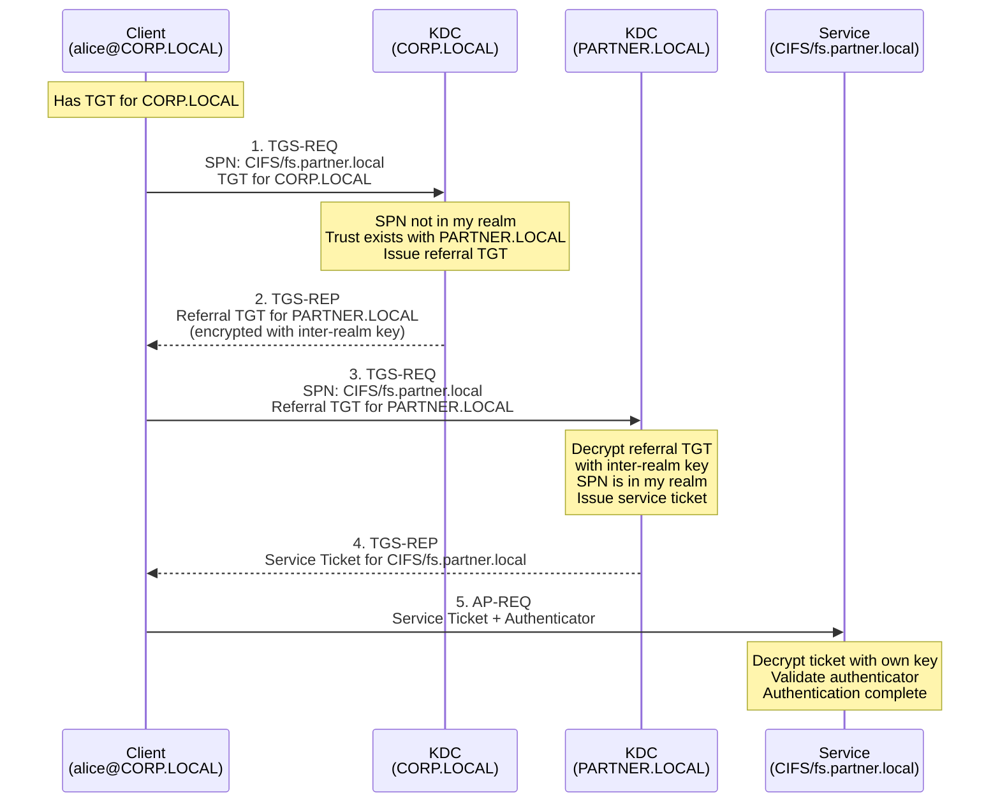
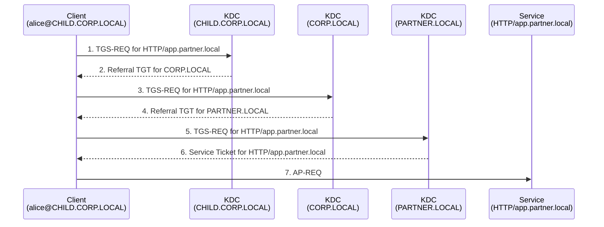

# Cross-Realm Authentication

How Kerberos works across domain and forest boundaries.

When a user in one domain needs to access a service in a different domain, the local KDC cannot
issue a service ticket for a foreign service - it does not know the foreign service's secret key.
Kerberos solves this through **referrals**: the local KDC gives the client a special TGT for the
foreign realm's KDC, and the client uses that to request a service ticket from the foreign realm.

---

## When Cross-Realm Authentication Is Needed

A single Kerberos realm (Active Directory domain) has its own KDC - in Active Directory, the KDC
service on every domain controller of that domain - that knows all the secret keys for
accounts in that domain. The KDC can only issue service tickets for services registered in its own
domain, because it needs the service's secret key to encrypt the ticket.

Cross-realm authentication is required whenever:

- A user in `CORP.LOCAL` accesses a file share on a server in `PARTNER.LOCAL`
- A user in `CHILD.CORP.LOCAL` accesses a web application registered in `CORP.LOCAL`
- Any Kerberos client needs a service ticket for an SPN in a different realm

---

## How Referrals Work

[RFC 4120 &sect;1.2](https://datatracker.ietf.org/doc/html/rfc4120#section-1.2) lets a client obtain, from its local realm, a TGT for a remote realm's
ticket-granting service, encrypted with an **inter-realm key** the two realms share. [RFC 6806 &sect;8](https://datatracker.ietf.org/doc/html/rfc6806#section-8)
adds the referral mechanism Active Directory uses: when a KDC receives a TGS-REQ for a service it
does not find in its own realm, it can return a **referral TGT** - a cross-realm TGT for the
next realm on the trust path - instead of an error.

### Basic Two-Domain Flow



### Step by Step

**Step 1** - The client has a TGT for `CORP.LOCAL` and needs a service ticket for
`CIFS/fs.partner.local`. It sends a TGS-REQ to the `CORP.LOCAL` KDC with the foreign SPN.

**Step 2** - The `CORP.LOCAL` KDC looks up the SPN and finds it is not in its domain. It checks
its trust relationships and finds a trust with `PARTNER.LOCAL`. The KDC issues a **referral TGT**:
a TGT with `sname = krbtgt/PARTNER.LOCAL@CORP.LOCAL`, encrypted with the **inter-realm key**
shared between the two domains.

**Step 3** - The client presents the referral TGT to the `PARTNER.LOCAL` KDC in a new TGS-REQ.

**Step 4** - The `PARTNER.LOCAL` KDC decrypts the referral TGT with its copy of the inter-realm
key, validates the request, and issues a service ticket for `CIFS/fs.partner.local` (encrypted
with the service's secret key).

**Step 5** - The client performs the normal [AP Exchange](ap-exchange.md) with the service.

!!! info "The client drives the process"
    The client follows the referral chain automatically. When it receives a TGS-REP with a
    referral TGT instead of a service ticket, it knows to contact the referred realm's KDC next.
    The `canonicalize` KDC option (kdc-options bit 15, [RFC 6806 &sect;3](https://datatracker.ietf.org/doc/html/rfc6806#section-3)) signals to the KDC
    that the client is prepared to follow referrals; server referrals themselves are described
    in [RFC 6806 &sect;8](https://datatracker.ietf.org/doc/html/rfc6806#section-8).

---

## Inter-Realm Keys

The trust between two Active Directory domains is backed by a shared secret - the **inter-realm
key**, derived from the trust password.

Two different kinds of object are involved, and they are easy to confuse. The trusted domain
object is specified in [MS-ADTS &sect;6.1.6.7](https://learn.microsoft.com/en-us/openspecs/windows_protocols/ms-adts/c9efe39c-f5f9-43e9-9479-941c20d0e590) and the interdomain trust account in
[MS-ADTS &sect;6.1.6.8](https://learn.microsoft.com/en-us/openspecs/windows_protocols/ms-adts/ac527b5b-0e88-48a1-8c73-497d40388d04):

Trusted domain object (TDO)
:   An object of class `trustedDomain` under `CN=System` in each domain, named after the partner
    domain. It holds everything about the trust: direction, type, attributes, and the trust
    passwords (in `trustAuthIncoming` and `trustAuthOutgoing`). The KDC takes the inter-realm key
    from the TDO ([MS-KILE &sect;3.3.5.7.5](https://learn.microsoft.com/en-us/openspecs/windows_protocols/ms-kile/bac4dc69-352d-416c-a9f4-730b81ababb3)).

Interdomain trust account
:   A **user** object named after the partner's NetBIOS name with a trailing `$` (for example
    `PARTNER$`), in the default Users container. It exists only for trusts that have an inbound
    direction, and it is associated with the TDO through that name.

When you create a two-way trust between `CORP.LOCAL` and `PARTNER.LOCAL`:

- `CORP.LOCAL` gets a TDO for `PARTNER.LOCAL` and an interdomain trust account `PARTNER$`
- `PARTNER.LOCAL` gets a TDO for `CORP.LOCAL` and an interdomain trust account `CORP$`
- Each direction of the trust has its own password, and both domains store it

The referral TGT is encrypted with the inter-realm key for the direction being traversed. Only
the two domains know the trust passwords, so only the foreign realm's KDC can decrypt it.

---

## Trust Path Traversal

When there is no direct trust between the client's domain and the service's domain, Kerberos
follows the **transitive trust chain** through intermediate realms.

### Example: Three-Hop Referral

Consider this trust structure, a two-domain forest with a forest trust to a second forest:

```
                    CORP.LOCAL          (forest root)
                   /          \
      CHILD.CORP.LOCAL     PARTNER.LOCAL  (forest trust)
```

A user in `CHILD.CORP.LOCAL` wants to access a service in `PARTNER.LOCAL`. There is no direct
trust between `CHILD.CORP.LOCAL` and `PARTNER.LOCAL`, but the trust is transitive through
`CORP.LOCAL`.



Each hop in the chain requires a separate TGS exchange. The client follows the referrals
automatically:

1. `CHILD.CORP.LOCAL` KDC does not know `PARTNER.LOCAL` directly, but knows its parent
   `CORP.LOCAL`. It issues a referral TGT for `CORP.LOCAL`.
2. `CORP.LOCAL` KDC has a trust with `PARTNER.LOCAL`. It issues a referral TGT for
   `PARTNER.LOCAL`.
3. `PARTNER.LOCAL` KDC issues the final service ticket.

!!! tip "Shortcut trusts reduce hops"
    In large forests with deep domain hierarchies, referral chains can get long. A **shortcut
    trust** is a manually created trust between two domains in the same forest that bypasses the
    hierarchy. This reduces the number of referral hops and speeds up cross-realm authentication.

---

## Trust Types in Active Directory

Active Directory supports several types of trust relationships, each with different properties
(Microsoft, [How Domain and Forest Trusts Work](https://learn.microsoft.com/en-us/previous-versions/windows/it-pro/windows-server-2003/cc773178%28v=ws.10%29)):

| Trust Type | Created | Direction | Transitive | Scope |
|---|---|---|---|---|
| **Parent-child** | Automatically when a child domain is created | Bidirectional | Yes | Between parent and child domains in the same tree |
| **Tree-root** | Automatically when a new tree joins the forest | Bidirectional | Yes | Between forest root and new tree root |
| **Forest** | Manually by administrators | Bidirectional or one-way | Yes | Between two separate forests (cross-forest) |
| **External** | Manually by administrators | Bidirectional or one-way | **No** | Between a specific domain and a domain in another forest |
| **Shortcut** | Manually by administrators | Bidirectional or one-way | Yes (within forest) | Between any two domains in the same forest to reduce referral hops |
| **Realm** | Manually by administrators | Bidirectional or one-way | Configurable | Between an AD domain and a non-Windows Kerberos realm (e.g., MIT Kerberos on Linux) |

### Transitive vs. Non-Transitive

Transitive trust
:   If domain A trusts domain B, and domain B trusts domain C, then domain A trusts domain C.
    All trusts within an Active Directory forest are transitive by default.

Non-transitive trust
:   Trust is limited to the two domains involved. External trusts are non-transitive - if
    `CORP.LOCAL` has an external trust with `LEGACY.LOCAL`, and `LEGACY.LOCAL` trusts
    `OTHER.LOCAL`, `CORP.LOCAL` does **not** automatically trust `OTHER.LOCAL`.

### Trust Direction

Bidirectional
:   Users in either domain can access resources in the other. Both sides share inter-realm keys.

One-way
:   Only one direction works. In a one-way trust where `CORP.LOCAL` trusts `PARTNER.LOCAL`,
    users in `PARTNER.LOCAL` can access resources in `CORP.LOCAL`, but not the reverse.

---

## The Transited Field

Per [RFC 4120 &sect;2.7](https://datatracker.ietf.org/doc/html/rfc4120#section-2.7), the `transited` field in a ticket records which intermediate realms were
traversed during cross-realm authentication. A KDC that issues a ticket on the strength of a
cross-realm TGT adds the name of the realm that issued that TGT, unless it is the client's own
realm ([RFC 4120 &sect;3.3.3.2](https://datatracker.ietf.org/doc/html/rfc4120#section-3.3.3.2)).

The two ends of the path are left out. The same section says: "The names of neither the local
realm nor the principal's realm are to be included in the transited field", so "both local and
single-hop inter-realm authentication result in a transited field that is empty." Under those
rules the ticket from the example above, where `CHILD.CORP.LOCAL` is the client's realm and
`PARTNER.LOCAL` is the service's, would list only the realm in between:

```
CORP.LOCAL
```

### Transited Policy Checking

[RFC 4120 &sect;2.7](https://datatracker.ietf.org/doc/html/rfc4120#section-2.7) makes the application server responsible for checking that only trusted realms
appear in the transited field. The KDC of the server's realm may apply a policy check of its own;
when it does and accepts the ticket, it sets the `TRANSITED-POLICY-CHECKED` flag (bit 12).

Under the RFC, application servers must either:

- Do their own transited-realm validation, **or**
- Reject cross-realm tickets that do not have the `TRANSITED-POLICY-CHECKED` flag set

Active Directory does not implement this check. Per
[MS-KILE &sect;3.1.5.4](https://learn.microsoft.com/en-us/openspecs/windows_protocols/ms-kile/de260077-1955-447c-a120-af834afe45c2): "KILE does not check for transited domains on servers or a KDC.
Application servers MUST ignore the TRANSITED-POLICY-CHECKED flag." What a domain controller
does check when a ticket arrives across a trust is the PAC, through SID filtering (see below),
and the client realm named in the cross-realm TGT ([MS-PAC &sect;4.1.2.3](https://learn.microsoft.com/en-us/openspecs/windows_protocols/ms-pac/6f9be500-7d76-45e1-8c66-116e8f55396f)).

!!! warning "Untrusted realms in the path"
    If a trust path passes through a compromised intermediate realm, that realm's KDC could modify
    the PAC or issue tickets with elevated privileges. This is why trust topology matters - only
    establish trusts with realms you actually trust. Forest trusts and external trusts limit the
    exposure by not being transitive beyond their defined scope.

---

## Cross-Realm Authentication and the PAC

When a ticket crosses realm boundaries, the PAC from the original TGT is carried forward into
each referral TGT and eventually into the final service ticket. Along the way SIDs are both
removed and added:

- **SID filtering removes SIDs.** When a KDC accepts a referral TGT across a trust, it filters
  the PAC and drops SIDs that the trusted domain is not allowed to assert
  ([MS-PAC &sect;4.1.2.2](https://learn.microsoft.com/en-us/openspecs/windows_protocols/ms-pac/55fc19f2-55ba-4251-8a6a-103dd7c66280)). Across a forest
  trust or a quarantined external trust, that means SIDs outside the trusted forest's or
  domain's own SID namespace - which is what stops a `sIDHistory` entry or an injected
  `ExtraSids` value for a privileged group in the *trusting* forest from taking effect.
- **The resource domain adds its own domain-local groups.** When the KDC of the service's domain
  issues the final service ticket, it adds the domain-local groups of that domain that the user
  (or any group already in the PAC) belongs to ([MS-KILE &sect;3.3.5.7.3](https://learn.microsoft.com/en-us/openspecs/windows_protocols/ms-kile/e55ad922-4940-432d-a253-41919d6efd24)). Domain-local groups
  are visible only inside their own domain, so this is the only point where they can be added.
- **Selective authentication adds a marker SID.** If the trust has the "selective
  authentication" attribute, the KDC adds the `OTHER_ORGANIZATION` SID to the PAC and the
  service ticket is issued only if the user holds the *Allowed to Authenticate* right on the
  target computer or service account ([MS-KILE &sect;3.3.5.7.5](https://learn.microsoft.com/en-us/openspecs/windows_protocols/ms-kile/bac4dc69-352d-416c-a9f4-730b81ababb3)).

The `KERB_VALIDATION_INFO` structure in the PAC has an `ExtraSids` field for SIDs from other
domains, which is where universal groups from other domains and `sIDHistory` values travel.

---

## TGT Delegation Across Trusts

[Unconstrained delegation](delegation.md#unconstrained-delegation) works by having the client
forward its TGT to the service. Across a forest or external trust that would hand a user's TGT
from the forest that holds the account (the *trusted* forest) to a server in the forest that
holds the resource (the *trusting* forest), which is a way for a compromised trusting forest to
attack the forest it trusts. In Microsoft's words: "An attacker that owns the trusting forest can
request delegation of a TGT for an identity from the trusted forest, giving it access to resources
in the trusted forest."

Since the 2019 security updates, Windows blocks this by default. Per
[Microsoft's guidance](https://support.microsoft.com/en-us/topic/updates-to-tgt-delegation-across-incoming-trusts-in-windows-server-1a6632ac-1599-0a7c-550a-a754796c291e),
TGT delegation is disabled on new and existing forest and external trusts once the May and
July 2019 updates are installed. The switch is the per-trust `EnableTGTDelegation` flag, set
with `netdom trust ... /EnableTGTDelegation:No|Yes`, and its secure value is `No`. In protocol
terms, the KDC does not set the `OK-AS-DELEGATE` flag on tickets that cross such a trust
([MS-KILE &sect;3.3.5.7.5](https://learn.microsoft.com/en-us/openspecs/windows_protocols/ms-kile/bac4dc69-352d-416c-a9f4-730b81ababb3)), so the client never forwards its TGT.

Trusts **within** a forest are not affected: unconstrained delegation between domains of the
same forest still works. Services that need delegation across a forest boundary should use
[resource-based constrained delegation](delegation.md#resource-based-constrained-delegation-rbcd),
which is designed to work across domains.

---

## Summary

- Cross-realm authentication uses referral TGTs to chain through trust relationships
- The inter-realm key (derived from the trust password held in the trusted domain object)
  encrypts referral TGTs
- Without a direct trust, the client follows the transitive trust path through intermediate
  realms automatically
- Active Directory supports multiple trust types: parent-child, tree-root, forest, external,
  shortcut, and realm trusts
- The transited field in tickets records the intermediate realms that were traversed. RFC 4120
  builds a policy check on it; Active Directory does not perform that check
- Shortcut trusts can reduce the number of referral hops in large forest hierarchies
- SID filtering removes SIDs a trusted domain may not assert; the resource domain adds its own
  domain-local groups
- TGT delegation across forest and external trusts has been blocked by default since 2019

Next: [Delegation](delegation.md), the three ways a service can act on a user's behalf.
