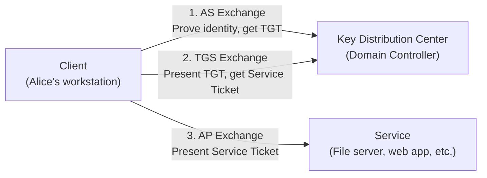

# How Kerberos Works

This section explains the Kerberos authentication protocol as implemented in Microsoft Active Directory. By the end, you will understand how clients prove their identity, how tickets move through the system, and why passwords never cross the network.

---

## What Kerberos Does

Kerberos is an **authentication** protocol. It answers one question: *"Are you really who you claim to be?"*

It does **not** handle authorization - the separate question of *"What are you allowed to do?"* A Kerberos ticket proves your identity the same way a passport proves your citizenship. The passport does not decide whether you can enter a building; a guard with an access list does that. In Active Directory, authorization happens after authentication, using security groups, access control lists (ACLs), and the Privilege Attribute Certificate (PAC) embedded in tickets.

!!! info "Authentication vs. Authorization"
    **Authentication** = proving identity ("I am Alice").
    **Authorization** = granting access ("Alice may read this file").
    Kerberos handles the first part. Windows authorization mechanisms handle the second.

---

## The Three-Party Model

Kerberos is named after the three-headed dog of Greek mythology, and the protocol involves three parties:

Client
:   The user or computer that wants to access a service. For example, a workstation where Alice types her password.

Service (Application Server)
:   The resource the client wants to reach - a file share, a web application, a database, a print server.

Key Distribution Center (KDC)
:   The trusted third party that vouches for identities. In Active Directory, the KDC runs on every Domain Controller and consists of two logical services:

    - **Authentication Service (AS)** - verifies the client's identity and issues a Ticket-Granting Ticket (TGT).
    - **Ticket-Granting Service (TGS)** - accepts a TGT and issues service tickets for specific services.

The core idea is simple: the client never sends a password to any service. Instead, the KDC acts as a mutually trusted intermediary. Both the client and the service trust the KDC, so when the KDC issues a ticket, both sides accept it as proof of identity.

---

## A Brief History

The Kerberos protocol was born out of a practical need: how do you let thousands of students share networked services without sending passwords over the wire?

| Year | Event |
|------|-------|
| 1983 | MIT launches **Project Athena** to build a campus-wide distributed computing environment. The project needs a network authentication system. |
| 1989 | **Kerberos V4** is publicly released. It works but relies exclusively on DES encryption and has limited extensibility. |
| 1993 | **Kerberos V5** is published as [RFC 1510](https://datatracker.ietf.org/doc/html/rfc1510). It adds support for multiple encryption types, cross-realm authentication, and extensible message formats. |
| 2000 | **Microsoft adopts Kerberos V5** as the default authentication protocol in Windows 2000 and Active Directory, replacing NTLM. Microsoft adds extensions defined in [MS-KILE](https://learn.microsoft.com/en-us/openspecs/windows_protocols/ms-kile/2a32282e-dd48-4ad9-a542-609804b02cc9), including the Privilege Attribute Certificate (PAC) for carrying authorization data. |
| 2005 | [RFC 4120](https://datatracker.ietf.org/doc/html/rfc4120) supersedes RFC 1510, clarifying and tightening the v5 specification. This is the current authoritative standard. |

!!! tip "NTLM is still around"
    Although Kerberos replaced NTLM as the default, Windows still falls back to NTLM when Kerberos is unavailable - for example, when a client cannot reach a Domain Controller, when accessing a resource by IP address instead of hostname (Kerberos for IP-address targets is opt-in, see [Protocol Overview](overview.md#infrastructure-dependencies)), or when communicating with systems that do not support Kerberos. Microsoft is retiring NTLM in stages: NTLMv1 is removed starting in Windows 11 24H2 and Windows Server 2025.

---

## Why Kerberos Matters

Passwords never cross the network
:   The user's password is converted into a cryptographic key on the local machine. Only encrypted data derived from that key is ever transmitted. Even the KDC never receives the password - it stores a copy of the derived key and uses it to verify encrypted timestamps.

Mutual authentication
:   Not only does the server verify the client, but the client can also verify the server. This prevents an attacker from impersonating a legitimate service.

Single Sign-On (SSO)
:   A user types a password once at login. From that point forward, the workstation uses cached tickets to authenticate to file shares, printers, email, web apps, and any other Kerberos-enabled service - all without prompting for credentials again.

Delegation
:   A front-end service can act on behalf of a user when talking to a back-end service. For example, a web application can request data from a SQL server using the logged-in user's identity, not a shared account identity.

Time-limited credentials
:   Tickets expire (default: 10 hours for a TGT). Even if an attacker captures a ticket, it becomes useless after expiration.

---

## Authentication Methods

Kerberos gives a client two fundamentally different ways to prove its identity during pre-authentication: a **symmetric key** derived from a password, or a **public key** via the PKINIT extension. PKINIT in turn has several deployment models in Active Directory. Understanding which method is in use matters because each has different attack surfaces, key material, and detection characteristics.

### 1. Key-Based (Symmetric)

The standard Kerberos authentication method, in use since Windows 2000. The client derives a secret key from the user's password using a key derivation function specific to the encryption type. Both the client and the KDC share this key (Active Directory stores the per-etype keys that were computed when the password was last set).

During pre-authentication, the client encrypts the current timestamp with the shared key (`PA-ENC-TIMESTAMP`) and sends it in the AS-REQ. The KDC decrypts the timestamp with its copy of the key - if the timestamp is valid, the client has proven knowledge of the password.

Supported encryption types (in order of strength):

| Encryption Type | Key Derivation | Status |
|----------------|---------------|--------|
| DES-CBC-MD5 | DES string-to-key over password + salt | Disabled by default since Windows 7 / Server 2008 R2; removed from Windows 11 24H2 and Windows Server 2025 |
| RC4-HMAC | MD4 hash of the password (identical to the NT hash), no salt | Deprecated. On DCs with the April 2026 cumulative update or later it is used only where an account or an explicit `DefaultDomainSupportedEncTypes` lists it, or where the temporary rollback offered by the April-June 2026 updates was applied. Targeted by Overpass-the-Hash |
| AES128-CTS-HMAC-SHA1-96 | PBKDF2 then DK, with the per-account salt supplied by the KDC | Supported |
| AES256-CTS-HMAC-SHA1-96 | PBKDF2 then DK, with the per-account salt supplied by the KDC | Preferred; default on modern DCs |

See [Encryption Types](encryption.md) for how each key is derived and for the current RC4 status.

### 2. Public Key (PKINIT)

PKINIT ([RFC 4556](https://datatracker.ietf.org/doc/html/rfc4556), with Microsoft's profile in [MS-PKCA](https://learn.microsoft.com/en-us/openspecs/windows_protocols/ms-pkca/d0cf1763-3541-4008-a75f-a577fa5e8c5b)) replaces the encrypted timestamp with a public-key proof. The client sends a `PA-PK-AS-REQ` containing a certificate and a signed authenticator; the KDC verifies the signature and maps the public key to an account. What differs between deployments is **how the KDC decides to trust the client's public key**:

Certificate trust (smart card logon, Windows Hello for Business certificate trust)
:   The client presents an X.509 certificate issued by Active Directory Certificate Services (AD CS) or another CA the KDC trusts. The KDC validates the chain and maps the certificate to an account. The private key lives on a smart card, a hardware token, or in a TPM.

Key trust (Windows Hello for Business key trust, and the Shadow Credentials attack)
:   The client presents a self-signed certificate, and the KDC matches its public key against the values stored in the account's `msDS-KeyCredentialLink` attribute. No certificate needs to be issued to the *user*, but this is still PKINIT, and the domain controllers still need a KDC certificate from a CA so that the client can authenticate the KDC. An attacker who can write to an account's `msDS-KeyCredentialLink` can add their own public key and then authenticate as that account - the Shadow Credentials attack.

Cloud Kerberos trust (Windows Hello for Business)
:   Microsoft Entra ID issues a partial TGT that an on-premises domain controller exchanges for a full one. It is not covered on this site.

!!! note "Scope of this site"
    This site focuses on **key-based (symmetric) authentication** - the password-derived secret keys (DES, RC4, AES) and the attacks that target them: password spraying, AS-REP roasting, Kerberoasting, overpass-the-hash, pass-the-key, Golden Tickets, and Silver Tickets. Public-key authentication (PKINIT in any of its trust models) and the attacks that target it - shadow credentials, pass-the-certificate, UnPAC the Hash, AD CS exploitation - are not covered here beyond the short description in [Pre-Authentication](preauth.md#pkinit-certificate-based-pre-authentication).

---

## Reading Order

This section walks through the protocol from the ground up. The pages follow the navigation order, and each one ends with a link to the next:

1. **[Active Directory Components](active-directory.md)** - Domains, forests, Domain Controllers, and how the KDC fits into AD.
2. **[Principals and Realms](principals.md)** - How users, computers, and services are named and identified.
3. **[Protocol Overview](overview.md)** - The three exchanges (AS, TGS, AP), key types, timestamps, and dependencies.
4. **[AS Exchange](as-exchange.md)** - Step-by-step: how a client proves its identity and obtains a TGT.
5. **[TGS Exchange](tgs-exchange.md)** - Step-by-step: how a client trades a TGT for a service ticket.
6. **[AP Exchange](ap-exchange.md)** - How the client presents a service ticket to the target service.
7. **[Ticket Structure](tickets.md)** - What is inside a ticket: fields, flags, and the PAC with its signatures.
8. **[Pre-Authentication](preauth.md)** - `PA-ENC-TIMESTAMP`, `PA-ETYPE-INFO2`, PKINIT, and FAST.
9. **[Encryption Types](encryption.md)** - DES, RC4, and AES: key derivation, salts, and current status.
10. **[S4U Extensions](s4u.md)** - S4U2Self and S4U2Proxy, the building blocks of constrained delegation.
11. **[Cross-Realm Authentication](cross-realm.md)** - Referrals, inter-realm keys, and trusts.
12. **[Delegation](delegation.md)** - Unconstrained, constrained, and resource-based constrained delegation.

The exchange pages (4-6) use ticket fields, pre-authentication data, and encryption types before the pages that define them. If a term is unfamiliar, pages 7-9 are the reference for it. Likewise, [S4U Extensions](s4u.md) and [Delegation](delegation.md) describe the same feature from the protocol side and the configuration side; read them together.

!!! info "Spec References"
    Throughout this section, citations such as [RFC 4120 &sect;3.1](https://datatracker.ietf.org/doc/html/rfc4120#section-3.1) link to the cited section of the Kerberos V5 specification, and citations such as [MS-KILE &sect;3.3.5.7](https://learn.microsoft.com/en-us/openspecs/windows_protocols/ms-kile/2e5dcf34-4b51-44a0-b45a-277ed616ca39) link to the cited section of Microsoft's Open Specifications. Microsoft revises those documents; where a page depends on the wording of a particular revision, it says so.

---

## Summary

- Kerberos is an authentication protocol with three parties: the client, the service, and the KDC that both trust
- In Active Directory the KDC runs on every Domain Controller and issues TGTs (AS exchange) and service tickets (TGS exchange)
- Passwords never cross the network; keys derived from them encrypt and decrypt protocol messages
- A client proves its identity either with a password-derived symmetric key or with a public key through PKINIT
- Authorization is not part of Kerberos itself; in Active Directory it rides along in the PAC

Next: [Active Directory Components](active-directory.md), the infrastructure Kerberos runs on.
