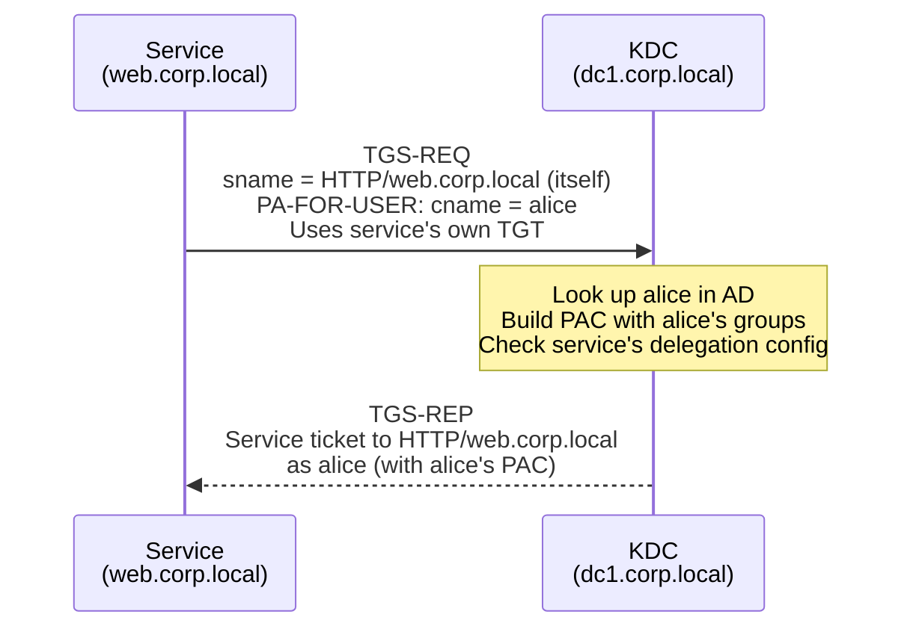
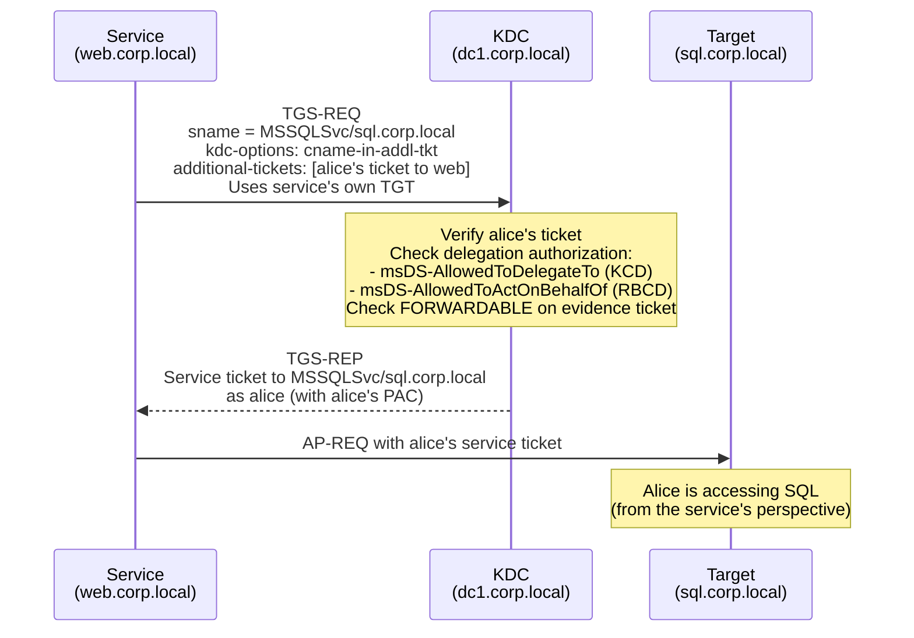
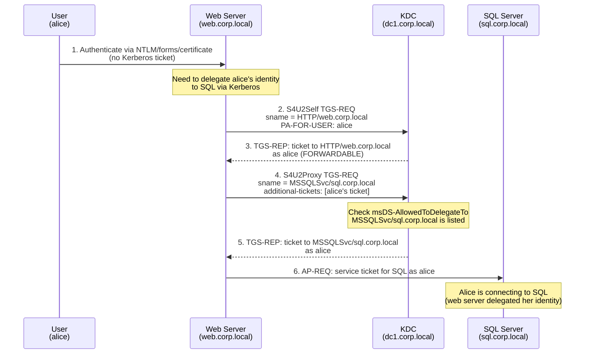

# S4U Extensions

S4U2Self and S4U2Proxy: how services request tickets on behalf of users.

The Service for User (S4U) extensions, defined in [MS-SFU](https://learn.microsoft.com/en-us/openspecs/windows_protocols/ms-sfu/3bff5864-8135-400e-bdd9-33b552051d94), add two sub-protocols to Kerberos
that allow a service to obtain service tickets **on behalf of a user** without possessing the
user's TGT or password. These extensions are the foundation of
[constrained delegation](delegation.md#constrained-delegation-s4u) and
[resource-based constrained delegation](delegation.md#resource-based-constrained-delegation-rbcd),
and they are central to several [delegation attacks](../attacks/delegation/delegation-attacks.md).

---

## S4U2Self (Service for User to Self)

S4U2Self allows a service to request a service ticket **to itself** on behalf of any user. The
resulting ticket contains the user's PAC (with real group memberships from Active Directory) as
if the user had directly requested a service ticket for that service through the normal
[TGS Exchange](tgs-exchange.md).

### Why It Exists

Consider a web server that authenticates users via forms-based login or client certificates --
mechanisms that produce a username but not a Kerberos ticket. If the web server needs to delegate
that user's identity to a back-end service via [S4U2Proxy](#s4u2proxy-service-for-user-to-proxy),
it first needs a Kerberos service ticket representing the user. S4U2Self bridges this gap: the
service says to the KDC, "give me a ticket to myself, as if this user had authenticated to me
via Kerberos." This process is called **protocol transition** -- converting a non-Kerberos
authentication into a Kerberos ticket that can participate in delegation.

### Protocol Flow

### Request Structure

The S4U2Self request is a standard TGS-REQ with two additions per [MS-SFU &sect;2.2.1](https://learn.microsoft.com/en-us/openspecs/windows_protocols/ms-sfu/aceb70de-40f0-4409-87fa-df00ca145f5a):

1. **PA-FOR-USER** (`padata` type 129) -- identifies the user being impersonated. Contains
   the user's principal name and realm, plus an HMAC-MD5 checksum over those fields keyed with
   the session key of the service's TGT.
2. The **sname** in `req-body` is the service's **own SPN** -- the service is requesting a
   ticket to itself.

!!! warning "PA-FOR-USER is being phased out in favor of PA-S4U-X509-USER (CVE-2026-20849)"
    The second padata type for S4U2Self, `PA-S4U-X509-USER` (`padata` type 130,
    [MS-SFU &sect;2.2.2](https://learn.microsoft.com/en-us/openspecs/windows_protocols/ms-sfu/cd9d5ca7-ce20-4693-872b-2f5dd41cbff6)), has existed for years. It can identify the user by name or by the
    **user's** certificate, and its checksum uses the regular Kerberos checksum for the TGT
    session key's encryption type instead of the fixed HMAC-MD5 that `PA-FOR-USER` uses.

    What the specification says today (MS-SFU as revised 30 March 2026):

    - [MS-SFU &sect;3.1.1](https://learn.microsoft.com/en-us/openspecs/windows_protocols/ms-sfu/8cc44c3e-953d-40b4-8fef-ac78a56c5432) defines `PhaseOutOldStyleS4U` as a setting of the **service** that
      sends the request, not of the KDC. It "requires S4USelf to use PA-S4U-X509-USER instead
      of PA-FOR-USER" and should be TRUE. A product note adds that Windows **without** the
      update for CVE-2026-20849 sets it to FALSE.
    - [MS-SFU &sect;3.1.5.1.1.1](https://learn.microsoft.com/en-us/openspecs/windows_protocols/ms-sfu/def5e449-f5b1-44d1-acca-1abc83285533): when the setting is TRUE the service sends only
      `PA-S4U-X509-USER`; when FALSE the old rules apply and `PA-FOR-USER` may still be sent.
    - Microsoft's advisory for CVE-2026-20849 (13 January 2026) describes a Kerberos elevation
      of privilege that requires an attacker to modify Kerberos traffic in transit.

    What this site has **not** confirmed: whether a patched domain controller rejects a request
    that carries only `PA-FOR-USER`, and on what schedule, if any, Microsoft will enforce that.
    The KDC processing rules in [MS-SFU &sect;3.2.5.1](https://learn.microsoft.com/en-us/openspecs/windows_protocols/ms-sfu/c98bade9-cad1-4745-bd4d-d13926103022) still accept either padata type. If you
    maintain or depend on non-Windows tooling that performs S4U2Self, test it against a patched
    DC instead of relying on this page.

The TGS-REQ is authenticated with the service's own TGT, proving the service's identity.

### FORWARDABLE Flag

The FORWARDABLE flag on the resulting S4U2Self ticket determines whether it can be used as
evidence in a subsequent S4U2Proxy request. [MS-SFU &sect;3.2.5.1.2](https://learn.microsoft.com/en-us/openspecs/windows_protocols/ms-sfu/ad98268b-f75b-42c3-b09b-959282770642) sets out when the KDC sets
it:

| Situation | FORWARDABLE on the S4U2Self ticket | Source |
|---|---|---|
| The requesting service has `TRUSTED_TO_AUTH_FOR_DELEGATION` (protocol transition enabled) | **Set** -- the KDC MUST set it | [MS-SFU &sect;3.2.5.1.2](https://learn.microsoft.com/en-us/openspecs/windows_protocols/ms-sfu/ad98268b-f75b-42c3-b09b-959282770642) |
| The requesting service does not have that flag, and its `msDS-AllowedToDelegateTo` is non-empty ("Kerberos only" constrained delegation) | **Not set** -- the KDC MUST NOT set it | [MS-SFU &sect;3.2.5.1.2](https://learn.microsoft.com/en-us/openspecs/windows_protocols/ms-sfu/ad98268b-f75b-42c3-b09b-959282770642) |
| The **user** being impersonated is marked "Account is sensitive and cannot be delegated" | **Not set** -- the KDC SHOULD NOT set it, whatever the service's configuration. Protected Users membership has the same effect through a different rule: the KDC MUST NOT set FORWARDABLE on tickets for a member when the domain controller functional level is 6 or higher | [MS-SFU &sect;3.2.5.1.2](https://learn.microsoft.com/en-us/openspecs/windows_protocols/ms-sfu/ad98268b-f75b-42c3-b09b-959282770642); for Protected Users, [MS-KILE &sect;3.3.5.1](https://learn.microsoft.com/en-us/openspecs/windows_protocols/ms-kile/f5993d64-a280-4555-9fcc-922fb934fc27) |
| The requesting service has neither the flag nor any `msDS-AllowedToDelegateTo` entries | Not prohibited. The specification names no rule that clears the flag in this case. | [MS-SFU &sect;3.2.5.1.2](https://learn.microsoft.com/en-us/openspecs/windows_protocols/ms-sfu/ad98268b-f75b-42c3-b09b-959282770642) |

The last row is the one that matters for resource-based constrained delegation. An ordinary
computer account has no delegation settings of its own, so nothing in the specification stops
its S4U2Self tickets for ordinary users from being forwardable. Whether RBCD needs them to be
is where the specification stops being consistent.

!!! info "RBCD and the forwardable flag: two sections of MS-SFU disagree"
    Earlier write-ups said that RBCD does not look at the FORWARDABLE flag on the evidence ticket.
    Two sections of the current specification bear on that, and they do not say the same thing:

    - **KDC rules.** [MS-SFU &sect;3.2.5.2.3](https://learn.microsoft.com/en-us/openspecs/windows_protocols/ms-sfu/dd1b47f9-580c-4c4e-8f34-4485b9728331) (revised 30 March 2026) says that when the
      delegation is authorized through `msDS-AllowedToActOnBehalfOfOtherIdentity` and the
      evidence ticket "is not set to forwardable", the KDC MUST return `KRB-ERR-BADOPTION`
      (the specification's spelling of `KDC_ERR_BADOPTION`) with `STATUS_ACCOUNT_RESTRICTION`.
      The accompanying product note ties this to the December 2020 update for CVE-2020-16996
      and its `NonForwardableDelegation` registry value;
      [Microsoft's deployment guidance](https://support.microsoft.com/en-us/topic/managing-deployment-of-rbcd-protected-user-changes-for-cve-2020-16996-9a59a49f-20b9-a292-f205-da9da0ff24d3)
      states that domain controllers are in enforcement mode from the 9 March 2021 update
      unless that value is set to disable it.
    - **Client rules.** [MS-SFU &sect;3.1.5.2.1](https://learn.microsoft.com/en-us/openspecs/windows_protocols/ms-sfu/ddb2cafd-1f01-4834-b52a-d4a5b34cd960) (revised 13 January 2026) still lists a
      "nonforwardable S4U2self-generated user's service ticket for a nonsensitive user" as
      evidence a service may send, and tells the service to fail the request only when the
      ticket is neither that nor forwardable.

    The two agree about a **sensitive** user, which &sect;3.1.5.2.1 defines by the
    `USER_NOT_DELEGATED` bit ("Account is sensitive and cannot be delegated"): a non-forwardable
    ticket for such a user is not acceptable evidence. Microsoft's guidance for CVE-2020-16996
    is about members of Protected Users, whose tickets are also non-forwardable; the client
    rules do not mention that group. The two sections differ about a non-forwardable ticket for
    any other user.

    This site has not tested which rule a current domain controller applies. In its lab a
    Server 2022 DC (build 20348.3207, tested April 2026) issued an RBCD ticket for an ordinary
    user to a service account that had no delegation settings, but the test did not record
    whether the intermediate S4U2Self ticket was forwardable, so it does not settle the
    question.

### Who Can Use S4U2Self

Any account with an SPN can perform S4U2Self. In practice, this means:

- **Computer accounts** -- every domain-joined computer has SPNs (`HOST/<hostname>`,
  `RestrictedKrbHost/<hostname>`) registered at join time
- **User accounts with SPNs** -- user service accounts with manually registered SPNs
- **Microsoft Virtual Accounts** -- `NT AUTHORITY\NETWORK SERVICE`, `defaultapppool`,
  `NT SERVICE\MSSQLSERVER`, etc. authenticate to the KDC as the computer account. Microsoft's
  [service accounts overview](https://learn.microsoft.com/en-us/windows-server/identity/ad-ds/manage/understand-service-accounts)
  puts it this way: "Services that run as virtual accounts access network resources by using
  the credentials of the computer account"

This is why S4U2Self is exploitable for [local privilege escalation](../attacks/delegation/s4u2self-abuse.md):
any code running as a virtual account on a domain-joined machine can request a ticket as Domain
Admin to the machine itself.

---

## S4U2Proxy (Service for User to Proxy)

S4U2Proxy allows a service to present a user's service ticket (obtained through S4U2Self or
through the user's actual Kerberos authentication) and request a **new service ticket for a
different target service** on behalf of that user.

### Why It Exists

S4U2Proxy is the delegation step. The front-end service already has a ticket proving the user's
identity (from S4U2Self or from the user's AP-REQ). Now it needs to access a back-end service
**as that user**. S4U2Proxy asks the KDC: "I have a ticket from alice to me; give me a ticket
from alice to the SQL server."

### Protocol Flow

### Request Structure

Per [MS-SFU &sect;3.1.5.2.1](https://learn.microsoft.com/en-us/openspecs/windows_protocols/ms-sfu/ddb2cafd-1f01-4834-b52a-d4a5b34cd960), the S4U2Proxy request is a TGS-REQ with:

1. The **`cname-in-addl-tkt`** KDC option (bit 14, [MS-SFU &sect;2.2.3](https://learn.microsoft.com/en-us/openspecs/windows_protocols/ms-sfu/17b9af82-d45a-437d-a05c-79547fe969f5)) -- this option is what
   marks the request as S4U2Proxy
2. **additional-tickets** -- contains the user's service ticket (the "evidence ticket") proving
   the user authenticated to the front-end service
3. **sname** in `req-body` -- the SPN of the **target** service (e.g., `MSSQLSvc/sql.corp.local`)
4. A **`PA-PAC-OPTIONS`** padata element (type 167) with the resource-based constrained
   delegation bit set ([MS-SFU &sect;2.2.5](https://learn.microsoft.com/en-us/openspecs/windows_protocols/ms-sfu/aeecfd82-a5e4-474c-92ab-8df9022cf955)), which tells the KDC that the client understands
   RBCD
5. No client name of its own: the user being impersonated is taken from the evidence ticket
6. The request is authenticated with the service's own TGT

The same section says which evidence tickets a service should send at all, and on that point it
differs from the KDC rules for RBCD; see [FORWARDABLE Flag](#forwardable-flag) above.

### KDC Authorization Check

The KDC performs different authorization checks depending on the delegation type:

**Constrained Delegation (KCD):**

Per [MS-SFU &sect;3.2.5.2.1](https://learn.microsoft.com/en-us/openspecs/windows_protocols/ms-sfu/6d76bf10-3c48-4e14-9992-df1bd456455e), the KDC checks whether the target SPN appears in the requesting
service's `msDS-AllowedToDelegateTo` attribute. If the SPN is not listed and the request does not
carry the RBCD bit, the request is rejected with `KDC_ERR_BADOPTION`.

The evidence ticket must have the FORWARDABLE flag set. This applies to every form of classic
constrained delegation. With protocol transition the S4U2Self ticket is forwardable; with
"Kerberos only" it is not, so the service must present a ticket the user obtained themselves.

**Resource-Based Constrained Delegation (RBCD):**

Per [MS-SFU &sect;3.2.5.2.3](https://learn.microsoft.com/en-us/openspecs/windows_protocols/ms-sfu/dd1b47f9-580c-4c4e-8f34-4485b9728331), if the delegation was not authorized through
`msDS-AllowedToDelegateTo`, the KDC of the target service builds an authorization context for the
requesting service from the PAC in its TGT and performs an access check against the **target**
service's `msDS-AllowedToActOnBehalfOfOtherIdentity` security descriptor. If the check fails the
request is rejected. The same section also requires the evidence ticket to be forwardable, which
the client rules in &sect;3.1.5.2.1 do not; see [FORWARDABLE Flag](#forwardable-flag) above for both
texts and the history of that requirement.

| Check | Constrained Delegation | RBCD |
|---|---|---|
| **Attribute checked** | `msDS-AllowedToDelegateTo` on the requesting service | `msDS-AllowedToActOnBehalfOfOtherIdentity` on the target service |
| **Who configures it** | Holders of `SeEnableDelegationPrivilege` (the Administrators group on domain controllers by default, which includes Domain Admins) | Anyone with write access to the target's AD object |
| **FORWARDABLE evidence ticket required** | Yes | Per the KDC rules (&sect;3.2.5.2.3), yes on DCs enforcing the CVE-2020-16996 fix (the default since the March 2021 updates); earlier DCs did not check. The client rules (&sect;3.1.5.2.1) still allow a non-forwardable S4U2Self ticket for a non-sensitive user. Not tested on this site |
| **Cross-domain** | No | Yes |

### Protected Users and Delegation-Sensitive Accounts

Certain accounts cannot be impersonated through S4U2Proxy:

- Accounts with the **"Account is sensitive and cannot be delegated"** flag set
  (`NOT_DELEGATED`, UAC bit `0x100000`)
- Accounts in the **Protected Users** group, whose tickets are issued as non-delegatable

When S4U2Self is used for these accounts, the resulting ticket does **not** have the
FORWARDABLE flag ([MS-SFU &sect;3.2.5.1.2](https://learn.microsoft.com/en-us/openspecs/windows_protocols/ms-sfu/ad98268b-f75b-42c3-b09b-959282770642)). Without that flag the ticket is rejected as
S4U2Proxy evidence, both for classic constrained delegation and -- on domain controllers
enforcing the CVE-2020-16996 fix -- for RBCD.

!!! warning "What these protections do not cover"
    The non-forwardable S4U2Self ticket is still a valid service ticket **to the requesting
    service itself**. A service, or anything running with a computer account's identity, can
    still obtain a ticket to itself in the name of a protected or sensitive user and use it
    locally -- see [S4U2Self Abuse](../attacks/delegation/s4u2self-abuse.md). The protection is
    against delegating that identity onward to another service.

    On a domain controller that predates the CVE-2020-16996 fix, or where enforcement has been
    turned off with `NonForwardableDelegation`, RBCD accepted non-forwardable evidence tickets,
    and Protected Users did not prevent impersonation through RBCD. Controlling who can write
    `msDS-AllowedToActOnBehalfOfOtherIdentity` remains the primary defense in every case.

---

## Combined S4U Flow

The most common delegation pattern chains S4U2Self and S4U2Proxy together. This is the full
flow for a web server performing protocol transition and constrained delegation to a SQL server:

---

## S4U2Self + U2U (User-to-User)

A variant of S4U2Self combines it with the User-to-User (U2U) Kerberos extension. In standard
S4U2Self, the resulting ticket is encrypted with the service's long-term key. In the U2U variant,
the resulting ticket is encrypted with the service's **session key** from its TGT instead.

This combination is used in the [Sapphire Ticket](../attacks/forgery/sapphire-ticket.md) attack:
the attacker uses S4U2Self+U2U to request a ticket on behalf of a high-privilege user, obtaining
a ticket that contains a **legitimate PAC** for that user. The PAC is then extracted and
transplanted into a forged TGT.

A related technique, UnPAC-the-Hash, also relies on U2U but has a precondition that is easy to
miss. The `PAC_CREDENTIAL_INFO` buffer, which holds NTLM credentials, is present only in the PAC
of a TGT that was obtained with **PKINIT**, and it is encrypted with the AS reply key of that
PKINIT exchange ([MS-PAC &sect;2.6.1](https://learn.microsoft.com/en-us/openspecs/windows_protocols/ms-pac/cc919d0c-f2eb-4f21-b487-080c486d85fe)). A principal that logged on with a certificate can request
a U2U ticket to itself, decrypt the PAC, and recover **its own** NT hash. It does not yield the
hash of a user who is merely being impersonated through S4U2Self.

---

## Security Implications

S4U2Self and S4U2Proxy are fundamental building blocks in delegation, but they introduce
significant attack surface:

| Attack | S4U Sub-protocol | Description |
|---|---|---|
| [S4U2Self Abuse](../attacks/delegation/s4u2self-abuse.md) | S4U2Self | Local privilege escalation via service ticket impersonation |
| [Constrained Delegation Abuse](../attacks/delegation/delegation-attacks.md#constrained) | S4U2Self + S4U2Proxy | Lateral movement through compromised delegating accounts |
| [RBCD Abuse](../attacks/delegation/delegation-attacks.md#rbcd) | S4U2Self + S4U2Proxy | Privilege escalation via writable computer objects |
| [SPN-jacking](../attacks/delegation/spn-jacking.md) | S4U2Proxy | Redirect delegation to attacker-controlled accounts by moving SPNs |
| [Sapphire Ticket](../attacks/forgery/sapphire-ticket.md) | S4U2Self + U2U | Obtain legitimate PAC for forged ticket construction |

---

## Summary

- **S4U2Self** allows a service to get a ticket to itself on behalf of any user, enabling
  protocol transition from non-Kerberos authentication to Kerberos delegation
- **S4U2Proxy** allows a service to exchange a user's evidence ticket for a new ticket to a
  target service, enabling the actual delegation hop
- For **constrained delegation**, the KDC checks `msDS-AllowedToDelegateTo` on the requesting
  service and requires FORWARDABLE evidence tickets
- For **RBCD**, the KDC checks `msDS-AllowedToActOnBehalfOfOtherIdentity` on the target. The
  specification's KDC rules also require a FORWARDABLE evidence ticket, enforced by default
  since the March 2021 updates for CVE-2020-16996, while its client rules still allow a
  non-forwardable S4U2Self ticket for a non-sensitive user; this site has not tested which
  applies
- Sensitive accounts and Protected Users members get non-forwardable S4U2Self tickets, which
  blocks onward delegation but not use of the ticket against the requesting service itself
- S4U2Self is available to any account with an SPN (all computer accounts), making it exploitable
  for [local privilege escalation](../attacks/delegation/s4u2self-abuse.md)
- The S4U2Self+U2U variant produces tickets with legitimate PACs, enabling the
  [Sapphire Ticket](../attacks/forgery/sapphire-ticket.md) attack

Next: [Cross-Realm Authentication](cross-realm.md), how tickets cross domain and forest
boundaries.
