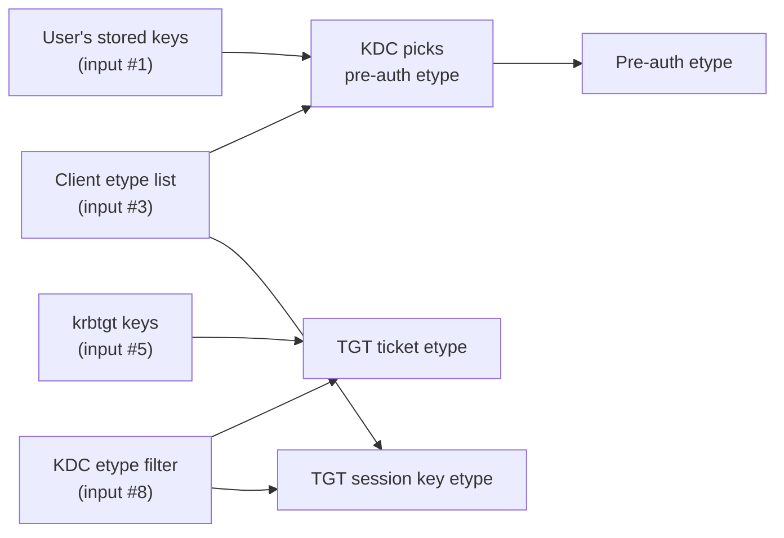
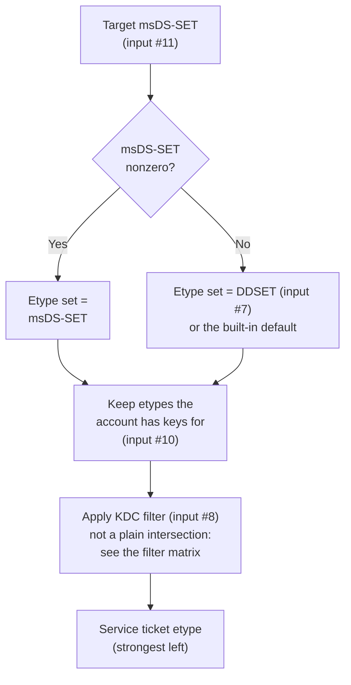
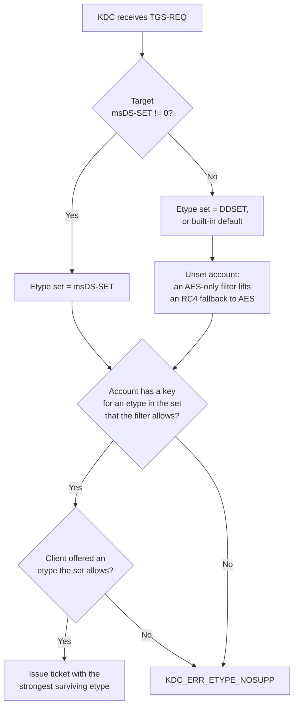

# How Encryption Types Are Chosen

A single Kerberos ticket involves more than a dozen inputs spread across AD attributes,
registry values, GPO settings, and stored keys.  This page maps every input and shows how
they combine at each stage of the authentication process.

[Encryption Type Negotiation](etype-negotiation.md) is the one-page summary.  This page is
the reference: where to look when the result is not what you expected.

---

## The Short Version (current domain controllers)

On a DC with the April 2026 update or later, for a service ticket:

1. If the target account has a nonzero `msDS-SupportedEncryptionTypes`, that is its etype
   set.  Otherwise the set is the DC's `DefaultDomainSupportedEncTypes` if present,
   otherwise `0x18` (AES128 + AES256).
2. The ticket is encrypted with the **strongest** etype in that set for which the account
   has a key.  No key for any etype in the set means `KDC_ERR_ETYPE_NOSUPP`; there is no
   silent fallback to RC4.
3. The session key must be an etype the client offered **and** the set allows; where several
   qualify, the client's order of preference decides (lab).  Nothing in common means
   `KDC_ERR_ETYPE_NOSUPP`.
4. The DC's `SupportedEncryptionTypes` filter, if configured, removes etypes the KDC may
   issue.  It never rescues an account whose explicit setting it excludes.

RC4 therefore appears only where something lists it explicitly: the account's attribute, or
an explicit DDSET.  On a DC **without** the April 2026 update, step 1 ends in `0x27`
instead of `0x18`, and unset accounts get RC4 tickets (KB5021131; lab-verified on Server
2022 only).

--8<-- "includes/ddset-default-by-build.md"

---

## All the Inputs

Every input that can influence which etype appears in a Kerberos ticket:

| # | Input | Where It Lives | What It Does | Who Sets It |
|---|---|---|---|---|
| 1 | **User account keys** | `ntds.dit` (replicated across DCs) | Determines which etypes the user *can* use for pre-auth.  If no AES keys exist, AES pre-auth is impossible. | Generated on password set/reset. |
| 2 | **User `msDS-SupportedEncryptionTypes`** | AD attribute on the user object | Declares which etypes the account supports **as a service**.  Affects service tickets *to* this account if it has an SPN.  Does **not** affect the user's own TGT, and does not decide which keys are generated. | Admin, via PowerShell or ADUC. |
| 3 | **Client `SupportedEncryptionTypes`** (registry) | `HKLM\...\Policies\System\Kerberos\Parameters` | Controls which etypes the Kerberos client offers in AS-REQ and TGS-REQ. | Group Policy. |
| 4 | **Client computer `msDS-SupportedEncryptionTypes`** | AD attribute on the computer account | Written by the machine itself from input #3.  Used by the KDC when issuing service tickets *to* this computer. | The machine.  Only the cipher bits (0-4) are written; the "Future encryption types" bits are dropped. |
| 5 | **`krbtgt` account keys** | `ntds.dit` | Determines the TGT ticket encryption etype.  With AES256 keys present, TGTs are AES256. | Generated when the krbtgt password is reset (see [KRBTGT rotation](mitigations.md#priority-9-krbtgt-password-rotation)). |
| 6 | **`krbtgt` `msDS-SupportedEncryptionTypes`** | AD attribute on the krbtgt account | Normally **0** (not set); the lab DC's was 0 and its TGTs were AES256.  Leave it unset. | Not normally set. |
| 7 | **DC `DefaultDomainSupportedEncTypes`** | `HKLM\SYSTEM\CurrentControlSet\Services\Kdc` | The **assumed** etypes for any account with `msDS-SupportedEncryptionTypes = 0`.  Consulted during TGS processing.  Per-DC, not replicated. | Manual registry edit or Group Policy Preferences.  **Not set by any GPO setting.** |
| 8 | **DC `SupportedEncryptionTypes`** (the KDC filter) | Policies path (GPO-written) or `Lsa\Kerberos\Parameters` | The KDC will not issue tickets with etypes absent from this value.  Read only at KDC start.  Which path a Server 2025 KDC reads is build-dependent; see [Registry Settings](registry.md#which-path-the-kdc-reads). | Group Policy (*Configure encryption types allowed for Kerberos*), or manual. |
| 9 | **DC computer `msDS-SupportedEncryptionTypes`** | AD attribute on the DC's computer account (e.g., `DC1$`) | Written by the DC itself from input #8.  Used only for service tickets *to* the DC (LDAP, CIFS on the DC).  It is not an input to tickets for other services. | The DC.  Lab: with `0x7FFFFFFF` at the Policies path (written by hand, not by a GPO), `DC1$` held 31 (`0x1F`). |
| 10 | **Target account keys** | `ntds.dit` | The KDC can only encrypt a service ticket with a key that exists.  No AES keys means no AES tickets, whatever the attribute says. | Generated on password set/reset. |
| 11 | **Target account `msDS-SupportedEncryptionTypes`** | AD attribute on the target account | **The primary control** for service ticket etype.  When nonzero, it replaces `DefaultDomainSupportedEncTypes` for that account. | Admin, via PowerShell, ADUC, or script. |
| 12 | **Target computer `SupportedEncryptionTypes`** (registry) | Same paths as input #3, on the target server | Controls the target server's Kerberos client, and (as in #4) what the server writes to its own computer account. | Group Policy on the target server. |
| 13 | **`KdcUseRequestedEtypesForTickets`** | `HKLM\SYSTEM\CurrentControlSet\Services\Kdc` | When `1`, the KDC takes the **ticket** etype from the client's preference list instead of picking the strongest.  On the enforcing build this only reaches accounts whose set still lists RC4. | Manual registry edit.  Never set it. |

Two further inputs act only in special cases and are described on their own pages: the
`UF_USE_DES_KEY_ONLY` account flag
([msDS-SupportedEncryptionTypes](msds-supported.md#the-use_des_key_only-override)) and, on
the January-June 2026 updates, the temporary `RC4DefaultDisablementPhase` value
([Registry Settings](registry.md#rc4defaultdisablementphase)).

---

## Step 1: Getting a TGT (AS Exchange)

When a user logs in, the client sends an AS-REQ and the KDC returns a TGT.

### Which inputs matter



| Component | Determined by | Notes |
|---|---|---|
| **Pre-authentication etype** | The client's etype list (#3) and the user's stored keys (#1).  Strongest common etype wins. | If the user has no AES keys, pre-auth uses RC4 regardless of policy, unless the KDC filter excludes RC4, in which case logon fails.  Server 2025 is a separate case: Microsoft states that its domain controllers "don't issue RC4 Ticket Granting Tickets" ([Detect and remediate RC4 usage in Kerberos](https://learn.microsoft.com/en-us/windows-server/security/kerberos/detect-remediate-rc4-kerberos)). |
| **TGT ticket encryption** | krbtgt's keys (#5) + KDC filter (#8). | AES256 where krbtgt has AES keys.  The client never decrypts the TGT. |
| **TGT session key** | The client's etype list (#3) and the KDC filter (#8).  Strongest common etype wins. | |

**Key point**: The user's `msDS-SupportedEncryptionTypes` (#2) does **not** determine the
TGT etype, and it does **not** decide which keys the account has.  Keys for every supported
etype are generated whenever the password is set, whatever the attribute says.  The
attribute only matters for service tickets issued *to* that account.

---

## Step 2: Getting a Service Ticket (TGS Exchange)

The client presents its TGT and requests a service ticket for a specific SPN.

### Which inputs matter



| Component | Determined by | Notes |
|---|---|---|
| **Service ticket encryption** | The target account's effective etype set (#11, or #7 / the built-in default when #11 is 0), the target's available keys (#10), and the KDC filter (#8).  Strongest surviving etype wins; for an unset account the filter step is not a plain intersection (see [the filter matrix](#the-precedence-ladder)). | **This is the etype that matters for Kerberoasting.**  The client's preference is not consulted. |
| **Service ticket session key** | An etype the client offered (#3) that the target's effective set and the KDC filter (#8) allow, in the client's order of preference (lab). | No overlap fails with `KDC_ERR_ETYPE_NOSUPP`.  Before the April 2026 update the KDC still handed an RC4-only client an RC4 session key for an AES-only account; on the enforcing build it refuses (lab).  See [the per-build table](etype-negotiation.md#session-keys-and-rc4-only-clients). |
| **TGS-REP encrypted part** | Same etype as the TGT session key. | The client decrypts this with its TGT session key. |

**Key point**: By default (`KdcUseRequestedEtypesForTickets` absent or `0`), the client's
etype preference has **no effect** on the service ticket encryption etype.  A Kerberoasting
attacker cannot force RC4 on an account that does not list RC4 by asking for RC4.  If
`KdcUseRequestedEtypesForTickets` is `1`, the client's preference is honored for any
account whose set still contains RC4 - and, on the pre-enforcement build tested (6-7 April
2026), even for AES-only accounts.  See [Registry Settings](registry.md#kdcuserequestedetypesfortickets).

---

## Step 3: Using the Service Ticket (AP Exchange)

The client sends the service ticket to the target service.  The service decrypts the
ticket's `enc-part` with its own long-term key.

The only requirement: the service must possess the key for whatever etype the KDC chose.
If the KDC issued an AES256 ticket, the service needs its AES256 key.  For a Windows service
this is automatic.

Problems arise when:

- The service runs from a **keytab** that contains only an RC4 key.  The KDC issues AES256
  because the account has AES keys in AD, and the service cannot decrypt it.  This is the
  case Microsoft's KB5073381 warns about for non-Windows devices after the April 2026
  update; the failure shows up at the service, not at the KDC.
- The service's keytab is stale and does not contain the current key.
- A password change generated new keys but the service has not picked them up.

---

## The Precedence Ladder

When the KDC selects the etype for a **service ticket**, it evaluates in this order:

1. **Target account `msDS-SupportedEncryptionTypes`** (input #11) - if nonzero, this is the
   etype set.
2. **DC `DefaultDomainSupportedEncTypes`** (input #7) - used only if the target's attribute
   is 0 or absent.  If this is also absent, the built-in default applies: `0x18` on the
   April 2026 update or later, `0x27` before (lab: Server 2022).
3. **Available keys on the target account** (input #10) - the KDC cannot use an etype the
   account has no key for.  An account at `0x18` with no AES keys **fails**; it does not
   fall back to RC4 (lab, enforcing build).
4. **KDC filter** (input #8) - the KDC will not issue an etype the filter excludes.
   **Requires a KDC restart** to take effect, unlike DDSET.

The filter step is not a plain intersection.  Measured behavior:

--8<-- "includes/kdc-filter-matrix.md"



---

## The AES-SK Split: When Ticket and Session Key Differ

The **ticket etype** and **session key etype** are chosen separately, so they can differ.
The case most people meet is an **RC4 ticket with an AES256 session key**, produced by the
AES-SK bit (`0x20`) that the November 2022 update (CVE-2022-37966) introduced.

!!! info "Mostly historical on patched DCs"
    Before the April 2026 update, every unset account got this split, because the built-in
    default was `0x27`.  On the April 2026 update or later an unset account is treated as
    `0x18` and gets AES256 for both, so the split can only arise where a value containing
    `0x20` without the AES bits is set **explicitly** - typically `0x24` on an account, which
    is what Microsoft's KB5073381 suggests for a service that cannot accept AES tickets.
    Whether a patched DC still produces the split for such an account has not been confirmed
    here; see the note under [When AES-SK applies](#when-aes-sk-applies).

### How it works

`0x27` and `0x24` both contain RC4 and the AES-SK bit, but **not** the AES128 / AES256 bits:

| Bit | Value | Meaning | In `0x27` | In `0x24` |
|---|---|---|---|---|
| 0 | `0x01` | DES-CBC-CRC | yes | no |
| 1 | `0x02` | DES-CBC-MD5 | yes | no |
| 2 | `0x04` | RC4-HMAC | yes | yes |
| 5 | `0x20` | **AES session key** (the SK flag) | yes | yes |

The strongest *ticket* etype in such a set is RC4, so the ticket is RC4.  [MS-KILE] section
2.2.7 describes the `0x20` bit as "Enforce AES session keys when legacy ciphers are in use":
when set, it "indicates to the KDC that all cases where RC4 session keys can be used will be
superseded with AES keys".

The lab result is narrower than that wording.  A client that offered only AES256, and a
Windows client (which lists AES256 first), received an AES256 session key.  A client that
listed RC4 first and AES256 last received an **RC4** session key, with DDSET at `0x24` or
`0x27` on the pre-April build and with DDSET at `0x24` on 20348.5020.  In those runs the bit
made an AES session key available for a set with no AES cipher bits; it did not override the
client's order of preference.

```
KerbTicket Encryption Type: RSADSI RC4-HMAC(NT)       ← RC4 (strongest ticket etype in the set)
Session Key Type:           AES-256-CTS-HMAC-SHA1-96   ← AES (from the 0x20 flag)
```

### When AES-SK applies

The split happens when **both** conditions are met:

1. The **effective** etype set for the target includes `0x20`.  That can be a per-account
   `msDS-SupportedEncryptionTypes`, an explicit `DefaultDomainSupportedEncTypes` (for unset
   accounts), or the pre-April built-in default.
2. The **client** offers AES in its TGS-REQ etype list and, in the lab runs, lists it ahead
   of RC4.

!!! info "AES-SK works on a per-account value"
    `msDS-SupportedEncryptionTypes = 0x24` (36) on an individual account produced RC4 tickets
    with AES256 session keys even when DDSET lacked the bit (lab, Windows client `klist`, on
    the pre-April build).  On the enforcing build the split was **not reproduced** with
    impacket (tested with DDSET = `0x24`), whose client at the time listed RC4 first and
    received an RC4 session key; a Windows-client retest on that build has not been done.

### Why it matters

The split protects the **live session** but does **not** protect against Kerberoasting.  The
ticket is still RC4, and an attacker cracks the ticket's `enc-part`, not the session key.
The fix is `msDS-SupportedEncryptionTypes = 0x18` on the account, once the service can
accept AES tickets.

---

## Common Mistakes

### 1. "I set AES-only GPO on DCs but services still get RC4 tickets"

The GPO writes `SupportedEncryptionTypes`, which acts as the KDC **filter** only after a KDC
restart.  Causes, most likely first:

1. **The KDC was not restarted.**  The filter is read only at service start.  Run
   `Restart-Service kdc` on each DC, one at a time.
2. **The GPO still allows RC4.**  The RC4 box is ticked, so nothing is filtered.
3. **The DC is Server 2025 on an older build.**  On the March 2026 build the KDC ignored the
   GPO's registry path entirely; see
   [Registry Settings](registry.md#which-path-the-kdc-reads).

With an AES-only filter active, an unset account gets AES tickets even if the DC's default
for unset accounts includes RC4.  Setting `DefaultDomainSupportedEncTypes = 0x18` as well
keeps the two settings aligned.

### 2. "I set `msDS-SupportedEncryptionTypes = 0x18` on a service and now it cannot authenticate"

The account has no AES keys.  Its password was last set before the domain generated AES
keys, or was set from a hash.  The KDC sees `0x18`, finds no AES key, and returns
`KDC_ERR_ETYPE_NOSUPP`.  It does **not** fall back to RC4.  On a patched DC the same thing
happens to an **unset** account with no AES keys, because the default is now `0x18`.

| Attribute on an account with only an RC4 key | Result (lab, enforcing build) |
|---|---|
| `0x18` | `KDC_ERR_ETYPE_NOSUPP` |
| unset | `KDC_ERR_ETYPE_NOSUPP` |
| `0x1C` | RC4 ticket |
| `0x04` | RC4 ticket |

**Fix**: reset the account's password to generate AES keys, then confirm they exist.  See
[Password resets and AES keys](algorithms.md#password-resets-and-aes-keys).  As a stopgap, `0x1C`
lets the account keep working on RC4 until the reset.

### 3. "Why is my TGT always AES256 even when my account only has RC4 configured?"

The TGT ticket etype is determined by **krbtgt's keys**, not your account's
`msDS-SupportedEncryptionTypes`.  Your attribute affects service tickets *to* you (if you
are also a user service account), not your own TGT.

### 4. "Does the GPO update `msDS-SupportedEncryptionTypes`?"

Indirectly, and only for the **computer account** of the machine the policy applies to.  The
GPO writes a registry value; the machine then writes the cipher bits to its own computer
account in AD.

Nothing updates:

- User accounts
- gMSA, MSA or dMSA accounts (even those used on that machine)
- The `krbtgt` account
- `DefaultDomainSupportedEncTypes` (a different registry value)

### 5. "I see `KDC_ERR_ETYPE_NOSUPP` after enabling AES-only on the DC GPO"

The filter now excludes RC4 (after the KDC restart), and the target account either:

- has `msDS-SupportedEncryptionTypes = 0x04` (explicit RC4-only), which shares nothing with
  the filter, or
- has no AES keys.

Unset accounts that **have** AES keys do not fail: the filter lifts them to AES.  The same
error also appears when the *client* can only do RC4 (new logons fail too, because the
filter applies to pre-authentication).

**Fix**: find every account that lacks AES keys or is explicitly RC4-only before applying an
AES-only filter.  See [Auditing Kerberos Keys](account-key-audit.md).

---

## Putting It All Together

For the step-by-step operational guide to standardizing AES across your domain, see
[Standardization Guide](aes-standardization.md).

---

## Worked Examples

The examples below were recorded on a Windows Server 2022 domain controller at
**build 20348.3207** (Microsoft's February 2025 update) using `kw-roast` and `kw-tgt`.  That
build is **pre-enforcement**: unset accounts fall back to `0x27`.  For the user accounts the
test client offered **only AES256** against the unset and AES-configured accounts, and
**only RC4** against the RC4-only accounts (Examples 2 and 10), where an AES256-only request
fails.  Example 5 is the exception: its AES128 session key comes from the 6-7 April 2026 run
on a pre-enforcement Server 2022 DC whose build revision was not recorded.  The two computer accounts (Examples 7 and 8)
come from a separate run with an RC4-only client in which only the ticket etype was
recorded.

Lab DC state:

- `SupportedEncryptionTypes` at the Policies path = `0x7FFFFFFF` (all types allowed; written
  by hand, not delivered by a GPO)
- `DefaultDomainSupportedEncTypes` = **not set**
- `DC1$` `msDS-SupportedEncryptionTypes` = 31 (`0x1F`)
- `krbtgt` `msDS-SupportedEncryptionTypes` = 0

!!! warning "What changes on a current DC"
    Six of the service accounts were re-measured on the enforcing build 20348.5020 in June
    2026.  Only the **unset** case changed its **ticket** etype.  Some of those runs used a
    client that lists RC4 first, so the session keys are not comparable with the column
    beside them:

    | Example | Account setting | Recorded here (20348.3207) | Enforcing build (20348.5020) |
    |---|---|---|---|
    | 1 | unset | RC4 ticket, AES256 session key | **AES256 ticket, AES256 session key** |
    | 2 | `0x04` | RC4 / RC4 | unchanged |
    | 3 | `0x18` | AES256 / AES256 | AES256 ticket (session key not recorded) |
    | 4 | `0x10` | AES256 / AES256 | AES256 ticket (session key not recorded) |
    | 5 | `0x08` | AES128 ticket (session key: see Example 5) | **`KDC_ERR_ETYPE_NOSUPP`**: the test client did not offer AES128.  AES128 / AES128 was not observed on this build |
    | 6 | `0x1C` | AES256 / AES256 | AES256 ticket, **RC4** session key (the test client listed RC4 first) |

    Examples 9 and 11 are also unset accounts and follow Example 1: expect AES256 on a
    patched DC.  They were not individually re-measured.  Enforcement depends on the
    installed update, not the date; see [the lab build table](registry-audit.md#lab-builds).

---

### Example 1: User account, unset (pre-enforcement default)

**Target**: `svc_app01` - SPN `HTTP/app01.corp.local`, `msDS-SupportedEncryptionTypes` = not set

The KDC sees `msDS-SET = 0` and substitutes `DefaultDomainSupportedEncTypes`.  The registry
value is not set, so on this pre-enforcement build the KDC uses the built-in default `0x27`
(DES + RC4 + AES-SK).  The **ticket** etype comes from the cipher bits, and RC4 is the
strongest of those in `0x27`.  **On a DC with the April 2026 update the default is `0x18`
and this account gets an AES256 ticket and session key.**

| Component | Etype | Reason |
|---|---|---|
| **Service ticket** | RC4-HMAC (0x17) | Default `0x27` → RC4 is the strongest standard etype in that bitmask |
| **Session key** | AES256 (0x12) | AES-SK bit (`0x20`) in `0x27` + client advertised AES256 → split etype |

**Event 4769 (abridged):**

```text title="Event 4769 - default etype, AES-SK split"
Service Name:                     svc_app01
MSDS-SupportedEncryptionTypes:    0x27 (DES, RC4, AES-Sk)
Available Keys:                   AES-SHA1, RC4
Advertized Etypes:                AES256-CTS-HMAC-SHA1-96
Ticket Encryption Type:           0x17
Session Encryption Type:          0x12
```

The field labels are the ones shown in the event's message text.  In the event XML the same
values are `ServiceSupportedEncryptionTypes`, `ServiceAvailableKeys`,
`ClientAdvertizedEncryptionTypes`, `TicketEncryptionType` and `SessionKeyEncryptionType`.
The supported-etypes field is a processed value: for an unset account it shows what the KDC
substituted, not the empty AD attribute.

This is the **AES-SK split** in action.  The ticket is RC4 (because `0x27` does not include
the AES128/AES256 bits), but the session key is AES256 (because `0x27` includes the AES-SK
bit and the client supports AES256).

!!! warning "The account has AES keys but gets an RC4 ticket"
    Note "Available Keys: AES-SHA1, RC4" - the account *has* AES keys.  But because
    `msDS-SupportedEncryptionTypes` is 0, this build falls back to `0x27`, which does not
    include the AES128/AES256 bits (only AES-SK).  **Having AES keys is necessary but not
    sufficient** - the effective etype set must also include AES.  The AES session key
    protects the live session but the RC4 ticket is still crackable.

---

### Example 2: User account, explicit RC4-only

**Target**: `svc_app02` - SPN `HTTP/app02.corp.local`, `msDS-SupportedEncryptionTypes` = 4 (`0x04`, RC4 only)

| Component | Etype | Reason |
|---|---|---|
| **Service ticket** | RC4-HMAC (0x17) | msDS-SET = RC4 only, KDC uses RC4 |
| **Session key** | RC4-HMAC (0x17) | The client in this run offered only RC4; msDS-SET = RC4 only and has no AES-SK bit |

**Event 4769:**

```text title="Event 4769 - explicit RC4-only configuration"
Service Name:                     svc_app02
MSDS-SupportedEncryptionTypes:    0x4 (RC4)
Available Keys:                   AES-SHA1, RC4
Ticket Encryption Type:           0x17
Session Encryption Type:          0x17
```

Both ticket and session key are RC4.  The account has AES keys ("Available Keys: AES-SHA1,
RC4") but gets RC4 for everything because the explicit `msDS-SupportedEncryptionTypes = 0x4`
replaces the default.  The AES-SK bit in the default `0x27` is **not** consulted because the
account has an explicit value; setting `0x24` on the account itself would bring it back.  A
client that offers only AES gets `KDC_ERR_ETYPE_NOSUPP` for this account.

---

### Example 3: User account, AES-only (AES128 + AES256)

**Target**: `svc_app03` - SPN `HTTP/app03.corp.local`, `msDS-SupportedEncryptionTypes` = 24 (`0x18`, AES128 + AES256)

| Component | Etype | Reason |
|---|---|---|
| **Service ticket** | AES256 (0x12) | msDS-SET includes AES256; KDC picks strongest |
| **Session key** | AES256 (0x12) | Client advertised AES256; service msDS-SET includes AES256; intersection = AES256 |

**Event 4769:**

```text title="Event 4769 - AES-only configuration, both ticket and session key AES256"
Service Name:                     svc_app03
MSDS-SupportedEncryptionTypes:    0x18 (AES128-SHA96, AES256-SHA96)
Available Keys:                   AES-SHA1, RC4
Ticket Encryption Type:           0x12
Session Encryption Type:          0x12
```

Both ticket and session key are AES256.  When the account's `msDS-SupportedEncryptionTypes`
includes AES and the client advertises AES, everything aligns to AES.  No split etype needed.

---

### Example 4: User account, AES256-only

**Target**: `svc_app04` - SPN `HTTP/app04.corp.local`, `msDS-SupportedEncryptionTypes` = 16 (`0x10`, AES256 only)

| Component | Etype | Reason |
|---|---|---|
| **Service ticket** | AES256 (0x12) | Only AES256 declared, KDC uses it |
| **Session key** | AES256 (0x12) | Client advertised AES256; service declares AES256; intersection = AES256 |

**Event 4769:**

```text title="Event 4769 - AES256-only configuration"
Service Name:                     svc_app04
MSDS-SupportedEncryptionTypes:    0x10 (AES256-SHA96)
Available Keys:                   AES-SHA1, RC4
Ticket Encryption Type:           0x12
Session Encryption Type:          0x12
```

---

### Example 5: User account, AES128-only

**Target**: `svc_app05` - SPN `HTTP/app05.corp.local`, `msDS-SupportedEncryptionTypes` = 8 (`0x08`, AES128 only)

| Component | Etype | Reason |
|---|---|---|
| **Service ticket** | AES128 (0x11) | Only AES128 declared |
| **Session key** | AES128 (0x11) | Recorded in the 6-7 April 2026 run (the notes do not state that client's etype list; an AES256-only request failed) |

This confirms the KDC respects the specific AES variant.  If only AES128 is declared, the
ticket uses AES128 even though the account also has AES256 keys.  The session key depends on
the client.  A client in the 6-7 April 2026 run received an AES128 session key.  On build 20348.3207 a client that offered only RC4 received the AES128 ticket with an
**RC4** session key: the pre-enforcement loosening described under
[Step 2](#step-2-getting-a-service-ticket-tgs-exchange).

!!! note "Client etype list matters for the session key"
    If a client offers AES256 but **not** AES128, the request for this account **fails** with
    `KDC_ERR_ETYPE_NOSUPP` (lab, both the pre-enforcement and the enforcing build; System
    event 16 was recorded on the enforcing build): there is no etype both sides accept, and
    the KDC does not fall back to RC4.  A
    standard Windows client offers both AES256 and AES128, so this is rare in practice, but
    several non-Windows tools offer AES256 only.

---

### Example 6: User account, RC4 + AES (strongest wins)

**Target**: `svc_app06` - SPN `HTTP/app06.corp.local`, `msDS-SupportedEncryptionTypes` = 28 (`0x1C`, RC4 + AES128 + AES256)

| Component | Etype | Reason |
|---|---|---|
| **Service ticket** | AES256 (0x12) | msDS-SET includes AES256; KDC picks strongest |
| **Session key** | AES256 (0x12) | Client advertised AES256; service msDS-SET includes AES256; intersection = AES256 |

**Event 4769:**

```text title="Event 4769 - RC4 + AES configuration, KDC picks strongest etype"
Service Name:                     svc_app06
MSDS-SupportedEncryptionTypes:    0x1C (RC4, AES128-SHA96, AES256-SHA96)
Available Keys:                   AES-SHA1, RC4
Ticket Encryption Type:           0x12
Session Encryption Type:          0x12
```

When an account supports both RC4 and AES, the KDC picks the **strongest** etype for the
ticket (AES256), not the weakest.  A Kerberoasting attacker cannot downgrade this to RC4 by
requesting RC4 in their TGS-REQ - the client's preference does not affect ticket encryption.
The session key here is AES256 because the test client offered only AES256.  A client that
offers only RC4, or that lists RC4 ahead of AES256, still gets the AES256 ticket, with an
**RC4** session key (lab: an RC4-only client on both builds, an RC4-first client on
20348.5020).

---

### Example 7: Computer account, AES-only

**Target**: `WS01$` - SPN `HOST/WS01.corp.local`, `msDS-SupportedEncryptionTypes` = 24 (`0x18`)

| Component | Etype | Reason |
|---|---|---|
| **Service ticket** | AES256 (0x12) | Computer account's msDS-SET = AES only |
| **Session key** | not recorded | The evidence for this example records the ticket etype only |

Computer accounts follow the exact same precedence as user accounts.  The only difference is
that a Windows computer writes its own `msDS-SupportedEncryptionTypes` from its Kerberos
etype policy, whereas user service accounts must be configured manually.

---

### Example 8: Computer account, RC4-only

**Target**: `SRV01$` - SPN `HOST/SRV01.corp.local`, `msDS-SupportedEncryptionTypes` = 4 (`0x04`, RC4 only)

| Component | Etype | Reason |
|---|---|---|
| **Service ticket** | RC4-HMAC (0x17) | Computer's msDS-SET declares RC4 only |
| **Session key** | not recorded | The evidence for this example records the ticket etype only |

This simulates a legacy server that has been explicitly configured (or misconfigured) for
RC4.  Even though the computer account has AES keys, the ticket is RC4 because the msDS-SET
restricts to RC4.

**Takeaway**: The KDC uses whatever is in the computer account's attribute at the time of
the request, however it got there.  A Windows machine normally rewrites its own attribute
from its etype policy (Microsoft says this happens when the machine restarts), so a manual
override on a Windows computer account should not be expected to last.  How quickly it is
overwritten was **not lab-verified**.

---

### Example 9: Protected Users member with SPN (unset)

**Target**: `svc_protected` - SPN `HTTP/app-protected.corp.local`, `msDS-SupportedEncryptionTypes` = not set, **member of Protected Users**

| Component | Etype | Reason |
|---|---|---|
| **Service ticket** | RC4-HMAC (0x17) | msDS-SET = 0 → pre-enforcement default `0x27` → RC4 |
| **Session key** | AES256 (0x12) | AES-SK bit in `0x27` + client advertised AES256 → split etype |

**Event 4769:**

```text title="Event 4769 - Protected Users member with no msDS-SET (service ticket still RC4)"
Service Name:                     svc_protected
MSDS-SupportedEncryptionTypes:    0x27 (DES, RC4, AES-Sk)
Available Keys:                   AES-SHA1, RC4
Ticket Encryption Type:           0x17
Session Encryption Type:          0x12
```

!!! warning "Protected Users does NOT protect the service ticket"
    Protected Users group membership affects the **member's own authentication** (AS exchange:
    AES-only pre-auth, 4-hour TGT).  It does **not** affect service tickets issued **for**
    the member's SPN.  On this build a Kerberoasting attacker requesting a ticket for
    `HTTP/app-protected.corp.local` gets an RC4 ticket regardless of `svc_protected`'s group membership.
    On the enforcing build the ticket is AES256, but it is still issued and still roastable
    (lab, June 2026): membership changes nothing about the member's service tickets.

    To protect this account's service tickets, set `msDS-SupportedEncryptionTypes = 0x18`
    on the account itself.

---

### Example 10: User account, RC4-only with SPN (edge case)

**Target**: `svc_legacy` - SPN `HTTP/app-legacy.corp.local`, `msDS-SupportedEncryptionTypes` = 4 (`0x04`, RC4 only)

| Component | Etype | Reason |
|---|---|---|
| **Service ticket** | RC4-HMAC (0x17) | Explicit RC4-only configuration |
| **Session key** | RC4-HMAC (0x17) | msDS-SET = RC4 only, no AES-SK bit |

**Event 4769:**

```text title="Event 4769 - explicit RC4-only, no AES-SK split"
Service Name:                     svc_legacy
MSDS-SupportedEncryptionTypes:    0x4 (RC4)
Available Keys:                   AES-SHA1, RC4
Ticket Encryption Type:           0x17
Session Encryption Type:          0x17
```

---

### Example 11: Unset account with MSSQLSvc SPN (the classic pre-2026 case)

**Target**: `svc_db01` - SPN `MSSQLSvc/db01.corp.local:1433`, `msDS-SupportedEncryptionTypes` = not set

Before the April 2026 update this was the most common Kerberoasting scenario: a SQL Server
user service account created by a DBA, with a password set by a human, and no etype
configuration.  It is still what you get from any DC that has not been updated.

| Component | Etype | Reason |
|---|---|---|
| **Service ticket** | RC4-HMAC (0x17) | Default `0x27` → RC4 |
| **Session key** | AES256 (0x12) | AES-SK bit in `0x27` + client advertised AES256 → split etype |

**Event 4769:**

```text title="Event 4769 - MSSQLSvc account with no msDS-SET, common Kerberoasting scenario"
Service Name:                     svc_db01
MSDS-SupportedEncryptionTypes:    0x27 (DES, RC4, AES-Sk)
Available Keys:                   AES-SHA1, RC4
Ticket Encryption Type:           0x17
Session Encryption Type:          0x12
```

**Why this was dangerous**: The account has AES keys, the DC supports AES, but nobody set
`msDS-SupportedEncryptionTypes` on the account.  The old default `0x27` includes RC4, so
the ticket is RC4 and crackable at full speed.  `Set-ADUser svc_db01 -Replace
@{'msDS-SupportedEncryptionTypes' = 24}` makes this ticket AES256 on every DC, patched or
not.  A patched DC does the same by default, but an AES256 ticket for a weak human-chosen
password is still crackable, only more slowly.

---

### Example 12: AES-configured MSSQLSvc account

**Target**: `svc_db02` - SPN `MSSQLSvc/db02.corp.local:1433`, `msDS-SupportedEncryptionTypes` = 24 (`0x18`)

| Component | Etype | Reason |
|---|---|---|
| **Service ticket** | AES256 (0x12) | msDS-SET = AES128 + AES256 → strongest wins |
| **Session key** | AES256 (0x12) | Client advertised AES256; service msDS-SET includes AES256 |

The identical service type (MSSQLSvc) but with `msDS-SupportedEncryptionTypes = 0x18`.  The
difference in cracking speed is roughly three orders of magnitude (see
[Cracking speed comparison](algorithms.md#cracking-speed-comparison)).

---

### Example 13: TGT etype verification

**Requesting user**: `alice`, `msDS-SupportedEncryptionTypes` = not set

| Component | Etype | Reason |
|---|---|---|
| **TGT ticket encryption** | AES256 (0x12) | krbtgt has AES256 keys, DFL >= 2008 |
| **TGT session key** | AES256 (0x12) | Intersection of client + KDC; both support AES256 |

The TGT is AES256 on this domain regardless of the requesting user's configuration.  The `krbtgt` account's `msDS-SupportedEncryptionTypes` is 0 (not set), but
the KDC uses krbtgt's actual stored keys (which include AES256).

This is why Mistake #3 above is so common - people see their TGT is AES256 and assume
they are "AES-only," but service tickets *to* other accounts may still be RC4.

---

### Example 14: Policies-path value → computer account `msDS-SupportedEncryptionTypes`

**Machine**: DC1 (domain controller)

| Setting | Value |
|---|---|
| `SupportedEncryptionTypes` at the Policies path | `0x7FFFFFFF` (every checkbox) |
| DC1$ `msDS-SupportedEncryptionTypes` (AD) | 31 (`0x1F` = all 5 standard etype bits) |
| `krbtgt` `msDS-SupportedEncryptionTypes` (AD) | 0 (unchanged) |
| `DefaultDomainSupportedEncTypes` (registry) | **not set** |

`0x7FFFFFFF` includes the "Future encryption types" bits (5-30).  The DC's computer account
held only the five cipher bits (0-4): `0x1F = 31 = DES_CRC + DES_MD5 + RC4 + AES128 + AES256`.
`0x1F` has no AES-SK bit.

`DefaultDomainSupportedEncTypes` did not exist in the DC's registry, and `krbtgt`'s
attribute was still 0: neither is touched by this setting.

!!! note "This value was written by hand"
    A later lab check found that the `0x7FFFFFFF` value on this DC had been written straight
    to the registry, not delivered by a linked GPO.  The observation above therefore shows
    what the machine does with a value at the Policies path.  That a real GPO writes to the
    same path was confirmed separately; the end-to-end GPO → attribute update was not
    re-run.

---

### Summary Table

Results as recorded on the pre-enforcement build 20348.3207.  Examples 13 and 14 are not
service-ticket requests and are not listed.

| # | Target | Type | `msDS-SET` | Has AES Keys | Ticket Etype | Session Etype | Split? | On an enforcing DC |
|---|---|---|---|---|---|---|---|---|
| 1 | svc_app01 | User | unset | Yes | RC4 (0x17) | AES256 (0x12) | Yes | AES256 / AES256 (lab) |
| 2 | svc_app02 | User | 4 (RC4) | Yes | RC4 (0x17) | RC4 (0x17) | No | same (lab) |
| 3 | svc_app03 | User | 24 (AES) | Yes | AES256 (0x12) | AES256 (0x12) | No | AES256 ticket (lab; session key not recorded) |
| 4 | svc_app04 | User | 16 (AES256) | Yes | AES256 (0x12) | AES256 (0x12) | No | AES256 ticket (lab; session key not recorded) |
| 5 | svc_app05 | User | 8 (AES128) | Yes | AES128 (0x11) | AES128 (0x11), 6-7 April 2026 run | No | `KDC_ERR_ETYPE_NOSUPP` (lab; the client did not offer AES128) |
| 6 | svc_app06 | User | 28 (RC4 + AES) | Yes | AES256 (0x12) | AES256 (0x12) | No | AES256 ticket, RC4 session key (lab; RC4-first client) |
| 7 | WS01$ | Computer | 24 (AES) | Yes | AES256 (0x12) | not recorded | - | same ticket etype expected (not re-measured) |
| 8 | SRV01$ | Computer | 4 (RC4) | Yes | RC4 (0x17) | not recorded | - | same ticket etype expected (not re-measured) |
| 9 | svc_protected | User (PU) | unset | Yes | RC4 (0x17) | AES256 (0x12) | Yes | AES256 ticket (lab, different PU account; session key not recorded) |
| 10 | svc_legacy | User | 4 (RC4) | Yes | RC4 (0x17) | RC4 (0x17) | No | same (not re-measured) |
| 11 | svc_db01 | User | unset | Yes | RC4 (0x17) | AES256 (0x12) | Yes | AES256 / AES256 (as Example 1) |
| 12 | svc_db02 | User | 24 (AES) | Yes | AES256 (0x12) | AES256 (0x12) | No | same (not re-measured) |

**Pattern**: on this build the AES-SK split (RC4 ticket + AES session key) appears for the
accounts whose **effective** set is `0x27`, which here means the unset ones (examples 1, 9,
11).  Accounts with an explicit value get exactly what that value says; an explicit value
that itself contains `0x20` without the AES bits (such as `0x24`) produces the same split.

"Has AES Keys" = Yes for all accounts in this lab because all passwords were set after the
domain began generating AES keys.  In production, check the available-keys field in
Event 4769, or run a [key audit](account-key-audit.md).
