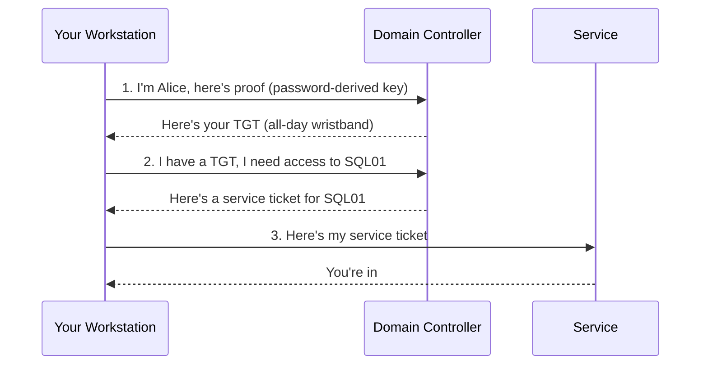
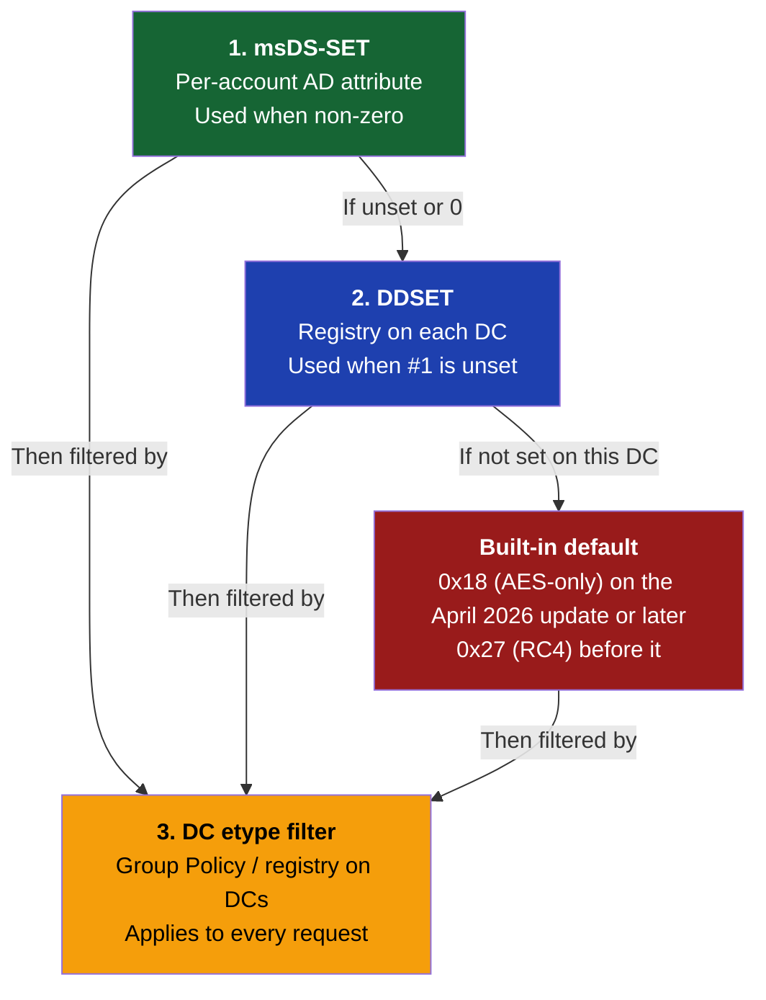
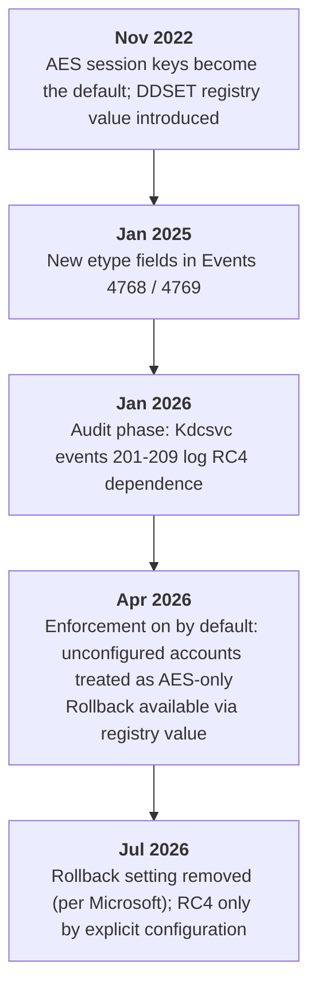
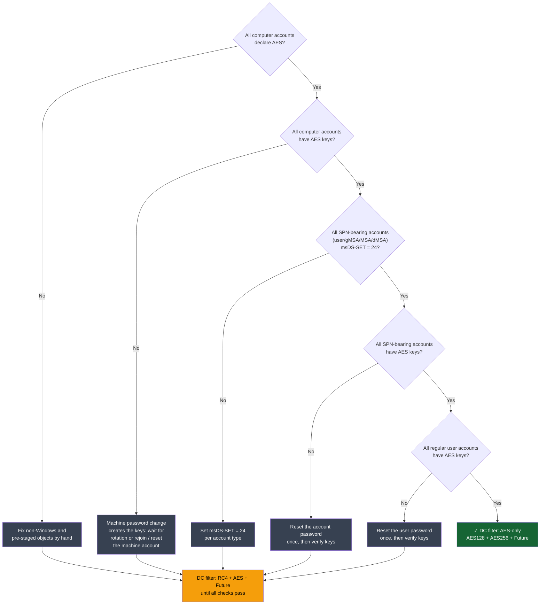

# Kerberos Encryption: The Short Version

This is the 5-minute version.  No protocol specs, no packet traces.  Just the big picture,
what changed in 2026, and what to do about it.

Need the per-domain checks?  Go to the [Security overview](index.md).  Something already
broken?  Go to [RC4 Enforcement: Am I Affected?](enforcement-triage.md).  Want the
migration playbook?  Go to the [Standardization Guide](aes-standardization.md).

---

!!! tldr "The 30-Second Version"

    - Every Kerberos ticket is encrypted.  The encryption type matters.
    - **RC4** was the default for 25 years.  It is weak, and it is no longer the default.
    - **AES** is the replacement.  Available since Server 2008.
    - **The switch has flipped.**  Domain controllers with the April 2026 update or later
      treat accounts without explicit encryption settings as AES-only.  Per Microsoft, the
      rollback setting went away with the July 2026 update.  If a service stopped working after a
      DC was patched, this is the first thing to check.
    - **Your move**: make sure every SPN-bearing account has AES keys, then set
      `msDS-SupportedEncryptionTypes = 24` on it.  Keep RC4 only as a documented
      per-account exception.

!!! info "As of 2026-11-10"
    Lab results on this site were last re-run on 2026-06-26.  What the July 2026 update
    did is stated here as Microsoft describes it (Message Center MC1427604,
    [KB5073381](https://support.microsoft.com/help/5073381)) and has not been lab-verified
    on this site.

---

## How Kerberos Authentication Works

You log in.  Your workstation talks to the Domain Controller (the KDC) and gets a
**Ticket-Granting Ticket** (TGT).  Think of the TGT as an all-day wristband at an amusement
park: it proves you already showed your ID at the gate.

When you need a service (file share, SQL server, web app), your workstation shows the TGT
to the DC and gets a **service ticket** for that specific service.  Think of service
tickets as ride tickets: one per ride, each locked with the service account's key.

That last part is what this page is about.  The encryption type of the service ticket
determines how hard it is to crack if someone captures it.



!!! info "Why does the encryption type matter?"
    Any authenticated domain user can request a service ticket for any SPN and try to crack
    it offline.  That works against both RC4 and AES tickets, but RC4 cracks at roughly
    **800x the speed of AES**.  At that ratio a password that falls in an hour from an RC4
    ticket takes about a month from an AES ticket: AES buys time, it does not make a weak
    password safe.  See
    [Kerberoasting](../attacks/roasting/kerberoasting.md).

---

## Why RC4 Was a Problem

RC4 was the implicit default for service accounts from Windows 2000 until the 2026
enforcement.

| | RC4 | AES |
|---|---|---|
| **Key derivation** | MD4 hash of the password (one pass, no salt) | PBKDF2 with a per-account salt and 4,096 iterations |
| **Key = NT hash?** | Yes: same key, same attack surface | No: a separate key |
| **Cracking speed** | ~800x faster than AES | Baseline |
| **Rainbow tables** | Work (no salt) | Do not work (salted per account) |
| **Status** | No longer assumed; explicit opt-in only | Current standard |

Both RC4 and AES service tickets can be Kerberoasted.  The difference is time.  AES does
not close the attack surface; it makes exploitation orders of magnitude slower.  Full
comparison at [Algorithms & Keys](algorithms.md).

---

## The Three Settings That Decide Encryption

Three settings decide which encryption a service ticket uses.  A fourth existed only for
the 2026 rollout and is now history.



1. **msDS-SupportedEncryptionTypes** is an AD attribute on each SPN-bearing account
   (service accounts, computers, gMSAs).  If it is non-zero, it is the account's declared
   set and the KDC picks the strongest etype in it that the account has a key for.  Target:
   `24` (`0x18` = AES128 + AES256).  [Full reference](msds-supported.md)

2. **DefaultDomainSupportedEncTypes (DDSET)** is a registry value on each DC.  It is the
   declared set for accounts that do not have #1.  It takes effect immediately, with no
   restart, and is not replicated between DCs.  If it is absent, the DC uses its built-in
   default: `0x18` (AES-only) with the April 2026 update or later, `0x27` (RC4) before
   that.  Target: absent (once every DC has that update), or `24`.
   [Full reference](registry.md#defaultdomainsupportedenctypes)

3. **SupportedEncryptionTypes (the Kerberos etype GPO)** applied to DCs is a filter over
   everything the KDC issues.  In the lab an AES-only filter also blocked RC4
   pre-authentication (seen on one pre-April 2026 Server 2022 build; not re-run on later
   builds).  It is read only when the KDC
   service starts.  If an account's explicit setting shares no etype with the filter, the
   request fails; the filter does not swap in a different etype.
   [Full reference](group-policy.md)

**Historical: RC4DefaultDisablementPhase.**  From January to July 2026 this registry value
selected audit, enforcement or rollback for the built-in default in #2.  Per Microsoft it
is no longer read after the July 2026 update.  Details are kept in
[RC4 Deprecation](rc4-deprecation.md#phase-behavior-what-the-registry-setting-actually-does).

!!! warning "The GPO does NOT set DDSET"
    The Kerberos etype GPO and `DefaultDomainSupportedEncTypes` are separate things.
    Setting the GPO does not populate DDSET, and setting DDSET does not need a GPO.  See
    [Registry Settings](registry.md).

!!! info "The client does not choose the service ticket etype"
    The KDC picks the service ticket etype from the **target account's** setting, not from
    what the client asked for.  A target at `msDS-SET = 4` (RC4-only) gets an RC4 ticket.
    A target at `msDS-SET = 28` (RC4 + AES) gets AES256, the strongest it has a key for.
    The client still matters for the **session key**: its etype list must overlap the
    target's set, or the request fails with `KDC_ERR_ETYPE_NOSUPP`.

---

## What Changed in 2026



Three things to keep straight:

- **It is tied to the update, not the date.**  A DC enforces once it has the April 2026
  cumulative update or anything newer.  A DC that has not been patched still issues RC4
  for unconfigured accounts.
- **Only unconfigured accounts changed.**  Accounts with an explicit
  `msDS-SupportedEncryptionTypes` kept their ticket etype.
- **Only service tickets changed.**  Logon (the AS exchange) is not part of this
  enforcement.

Full detail, with sources, at [RC4 Deprecation](rc4-deprecation.md).

---

## Are You Already Broken?

Three checks, in this order.  The [triage runbook](enforcement-triage.md) has the queries
and the fix for each result.

1. **Kdcsvc events 203, 204, 208, 209** in the System log on DCs.  These are the KDC
   saying "I refused this request because of RC4 enforcement".
2. **Event 4769 failures** in the Security log with `Status` `0xe` and
   `Ticket Encryption Type` `0xffffffff`.
3. **Accounts with no AES keys** whose `msDS-SupportedEncryptionTypes` is unset or `24`.
   They work until the first request reaches an enforcing DC, then fail.

A fourth case leaves no trace on the DC: a non-Windows service whose **keytab only has RC4
keys**.  The KDC now hands out an AES ticket and the service cannot decrypt it.

---

## What You Need to Do

### Step 1: Find all SPN-bearing accounts

Service tickets are encrypted with the **target account's** key, so the accounts that hold
SPNs are the ones that matter.  Five types can have SPNs: user service accounts, computer
accounts, gMSA, MSA, and dMSA.

```powershell
# krbtgt is in this list too (its SPN is kadmin/changepw).  Leave it unset.
Get-ADObject -LDAPFilter '(servicePrincipalName=*)' `
    -Properties objectClass, 'msDS-SupportedEncryptionTypes' |
    Select-Object Name, objectClass, 'msDS-SupportedEncryptionTypes'
```

For a grouped summary by account type, see the
[full SPN overview query](msds-supported.md).

### Step 2: Check their encryption type settings

Look at `msDS-SupportedEncryptionTypes` on each account.  You want `24` (AES128 + AES256).

On an enforcing DC, three cases matter:

- **Unset or `0`**: treated as AES-only.  If the account has no AES keys, every request for
  that service fails.
- **Any value that includes RC4** (bit `4`, for example `4`, `28` or `36`): RC4 is still
  available for that account, because you asked for it.  Kerberoastable at RC4 speed.
- **`24`**: correct.  No action needed.

--8<-- "includes/etype-values.md"

Use the [Encryption Type Calculator](etype-calculator.md) to decode any value you find.

### Step 3: Verify and reset AES keys

`msDS-SupportedEncryptionTypes` only declares what the account supports.  The keys must
actually exist in the database.  AES keys are generated when a password is set while the
domain is at functional level 2008 or higher.  A password older than that means RC4-only
keys.

**Why this matters:**

- **SPN-bearing account with no AES keys and `msDS-SET` = 24 (or unset, on an enforcing
  DC)**: the service is broken.  The KDC needs an AES key, finds none, and returns
  `KDC_ERR_ETYPE_NOSUPP`.

- **Regular user or computer account with no AES keys**: what breaks depends on the DC
  etype filter.
    - **Filter blocks RC4**: the user cannot log in.  Pre-authentication needs a key the
      account does not have.
    - **Filter allows RC4**: the user logs in using RC4 pre-authentication.  The TGT itself
      is still AES256, because it is encrypted with the `krbtgt` key.  The user can reach
      AES-only services, since the service ticket etype comes from the target account.

    Both outcomes are the expected behavior: a logon by an account that holds only an RC4
    key has not been run in this site's lab.  Server 2025 DCs are a separate case.
    Microsoft states that they "don't issue RC4 Ticket Granting Tickets", so expect such
    an account to fail there whatever the filter allows (details in the
    [Security overview](index.md#what-happened-to-each-kind-of-account)).

Find accounts whose password predates AES key generation:

--8<-- "includes/old-passwords-query.md"

Reset the password **once** on any account that shows up, then confirm the keys exist,
before setting `msDS-SET = 24` on it.  A reset raises the key version number, so any keytab
exported for that account must be regenerated.  For definitive key auditing, see
[Auditing Kerberos Keys](account-key-audit.md).

### Step 4: Set msDS-SET = 24 on SPN-bearing accounts

**User service accounts, gMSA, MSA, dMSA** are set by hand:

```powershell title="One account"
Set-ADUser -Identity svc_sql -Replace @{ 'msDS-SupportedEncryptionTypes' = 24 }
```

!!! danger "Do not pipe every SPN-bearing user into Set-ADUser"
    `Get-ADUser -Filter 'servicePrincipalName -like "*"'` also returns `krbtgt` (its SPN is
    `kadmin/changepw`), and a blanket `-Replace` overwrites the RC4 exceptions you created
    on purpose and breaks any account that has no AES keys.  For bulk changes use the
    scripts in the
    [Standardization Guide](aes-standardization.md#step-3-set-msds-supportedencryptiontypes-on-manually-managed-spn-bearing-accounts)
    and review their dry-run output first.

**Computer accounts** maintain their own value: Windows writes it, and the Kerberos etype
GPO changes what it writes.  Objects that are unset or `0` are usually non-Windows devices
(NAS, printers, Linux hosts), pre-staged objects, or machines that have been offline for a
long time:

```powershell
Get-ADComputer -Filter * -Properties 'msDS-SupportedEncryptionTypes', LastLogonDate |
    Where-Object { [int]$_.'msDS-SupportedEncryptionTypes' -eq 0 } |
    Select-Object Name, LastLogonDate | Sort-Object LastLogonDate
```

Handle those one at a time.  A non-Windows object needs AES keys in its keytab before its
AD object is set to `24`.

### Step 5: Decide what the DC default should be

`DefaultDomainSupportedEncTypes` is the fallback for any account whose `msDS-SET` is unset.
On a DC with the April 2026 update or later, leaving it absent already means AES-only.

- If **every** DC is on the April 2026 update or later: leave it absent.
- If DC patch levels are mixed, or you want the default pinned regardless of update level:
  set `24` on **every** DC.

```powershell
# Run on every DC.  Immediate; no restart; not replicated.
$kdc = 'HKLM:\SYSTEM\CurrentControlSet\Services\Kdc'

# Show the current value first and note it down.  No output means the value is absent.
Get-ItemProperty -Path $kdc -Name 'DefaultDomainSupportedEncTypes' -ErrorAction SilentlyContinue |
    Select-Object DefaultDomainSupportedEncTypes

New-ItemProperty -Path $kdc -Name 'DefaultDomainSupportedEncTypes' -PropertyType DWord -Value 24 -Force
```

To put it back, write the value you noted with the same `New-ItemProperty` line, or, if
there was none, remove it with
`Remove-ItemProperty -Path 'HKLM:\SYSTEM\CurrentControlSet\Services\Kdc' -Name DefaultDomainSupportedEncTypes`.
On a DC without the April 2026 update, removing it returns that DC to the RC4 default.

Do not leave a value that includes RC4 in place: it turns RC4 back on for every
unconfigured account that DC serves.

### Step 6: Remove RC4 from the DC etype filter (last)

This is the final step for an AES-only domain, and the one most likely to cause an outage
if done early.

The DC etype filter covers everything the KDC issues.  On the one pre-April 2026 Server
2022 build where it was checked in the lab, it also covered the pre-authentication the
KDC accepts.  With RC4 removed from it:

- an account explicitly set to RC4-only (`4`) fails with `KDC_ERR_ETYPE_NOSUPP` (lab:
  Server 2022 build 20348.5020);
- a user with no AES keys is expected to be unable to log on (not lab-run with such an
  account);
- nothing can fall back to RC4, whatever the account or DDSET says.

In Group Policy Management, create or edit a GPO linked to the **Domain Controllers** OU:

**Computer Configuration → Policies → Windows Settings → Security Settings → Local
Policies → Security Options → Network security: Configure encryption types allowed for
Kerberos**

```
[ ] DES_CBC_CRC
[ ] DES_CBC_MD5
[ ] RC4_HMAC_MD5
[x] AES128_HMAC_SHA1
[x] AES256_HMAC_SHA1
[x] Future encryption types
```

The filter is only read at KDC start.  After the policy has applied, restart the KDC on
**one** DC, test, then continue one DC at a time:

```powershell
Restart-Service kdc
```

!!! warning "Server 2025 domain controllers"
    The policy writes its value under the `Policies` registry path.  On the one Server 2025
    build tested (26100.32522) the KDC honored only the `Lsa` path and ignored
    `Policies`, so this GPO did not filter anything there.  That build predates the April
    2026 update for Server 2025 (KB5082063), whose release note says Kerberos encryption
    policy settings are read "as expected"; it has not been retested here.  Check each
    DC's behavior before relying on it.  See [Registry Settings](registry.md#supportedencryptiontypes-gpo-kdc-filter).

!!! warning "Do this last"
    Confirm Steps 1-5, and confirm there are no Kdcsvc 203/204/208/209 events and no
    remaining RC4 exceptions, before removing RC4 from the filter.  To back out: tick
    RC4 again, let policy apply, and restart the KDC on each DC.

See [Group Policy](group-policy.md) for the full reference.

---

## Keeping RC4 for Specific Accounts

A legacy service that cannot move to AES yet can keep RC4 without weakening the rest of the
domain.  Set the exception on **that account**, and make sure the DC etype filter (if you
have one) still allows RC4.

Which value to use depends on why the account needs RC4:

| Situation | Value on the service account |
|---|---|
| The service cannot decrypt AES tickets (for example an RC4-only keytab) | `36` (`0x24`, Microsoft's recommendation) or `4` |
| The account has no AES keys yet | Reset the password.  `28` only as a bridge until then. |
| A client can only do RC4 | `28`, so an RC4 session key can be agreed |

The full how-to, with commands and the conditions for each row, is in
[RC4 Deprecation: Keeping RC4 for specific accounts](rc4-deprecation.md#rc4-exceptions).

!!! warning "Every RC4 exception is Kerberoastable at RC4 speed"
    Use a 30+ character random password (or migrate to gMSA), record an owner and a review
    date, and treat the exception as temporary.  See [Mitigations](mitigations.md).

---

## Are You Ready for an AES-Only DC Filter? { #are-you-ready-for-an-aes-only-dc-filter }

Once RC4 is removed from the DC etype filter, any account or device that cannot do AES is
locked out.  Work through every check first.



Until every check passes, the DC filter must keep RC4 alongside AES so accounts and devices
that are not ready can still authenticate.

---

## Common Gotchas

- **Several registry paths look right; few are.**  `SupportedEncryptionTypes`,
  `DefaultDomainSupportedEncTypes` and friends each work at specific paths only, and on
  the one Server 2025 build tested (26100.32522, the March 2026 update) the filter path
  that worked was not the one Server 2022 prefers.  Setting the wrong one does nothing.
  [Registry Audit](registry-audit.md) maps which paths are functional.

- **The filter and the default are separate.**  The Kerberos GPO creates a *filter*.  DDSET
  sets a *default* for accounts that do not declare anything.  Setting one does not set the
  other.

- **The filter waits for a restart.**  A GPO change to the DC etype filter does nothing
  until the KDC service restarts, which may be weeks later at the next reboot.

- **Old accounts might not have AES keys.**  Asking for AES on an account with no AES keys
  is a failure, not a fallback.  Reset the password first.

- **A password reset invalidates keytabs.**  The key version number goes up; every keytab
  for that account must be regenerated.

!!! danger "Never set KdcUseRequestedEtypesForTickets = 1"
    This registry value makes the KDC follow the *client's* etype preference when it picks
    the ticket etype.  On the enforcing build tested in the lab (Server 2022 20348.5020), a
    client could use it to pull an RC4 ticket for any account whose
    `msDS-SupportedEncryptionTypes` still lists RC4; AES-only accounts were not affected.
    On one pre-April 2026 Server 2022 build (tested 6-7 April 2026, revision not recorded)
    it also returned an RC4 ticket for an AES-only account.  There is no
    good reason to set it.  See
    [Registry Settings](registry.md#kdcuserequestedetypesfortickets).

??? note "Historical: the April-July 2026 rollback window"
    Between the April and July 2026 updates, a DC could be returned to the old RC4 default
    by setting `RC4DefaultDisablementPhase` to `1` (audit) or `0` (no audit) under
    `HKLM\SOFTWARE\Microsoft\Windows\CurrentVersion\Policies\System\Kerberos\Parameters`
    and restarting the KDC.  Per Microsoft, the July 2026 update stopped reading the value,
    so this is no longer a way out.  If you find the value on a DC today, check that DC's
    build before you touch it.  On a July 2026 or later update (Server 2022 build
    20348.5386 or higher, Server 2025 build 26100.33158 or higher) Microsoft says it is no
    longer read, so it can be deleted.  On a DC that has only an April-June 2026 update, a `0` or `1` is
    still holding that DC on the RC4 default, and deleting it turns enforcement on at the
    next KDC restart: work through the [triage runbook](enforcement-triage.md) for that
    DC first.  The
    value table is kept in
    [RC4 Deprecation](rc4-deprecation.md#phase-behavior-what-the-registry-setting-actually-does).

---

## Quick Reference

| Setting | Where | Target value | Takes effect | Details |
|---------|-------|-------------|--------------|---------|
| msDS-SupportedEncryptionTypes | AD attribute on each SPN account | `24` (`0x18`) | Once replicated; new tickets only | [msDS-SET reference](msds-supported.md) |
| DefaultDomainSupportedEncTypes | Registry on each DC (`Services\Kdc`) | Absent, or `24` (`0x18`) | Immediately | [Registry reference](registry.md#defaultdomainsupportedenctypes) |
| SupportedEncryptionTypes (GPO) | Group Policy on the Domain Controllers OU | AES128 + AES256 (+ RC4 while exceptions exist) | After KDC restart | [GPO reference](group-policy.md) |
| RC4DefaultDisablementPhase | Registry on DCs (`Policies\...\Kerberos\Parameters`) | Absent (historical; no longer read per Microsoft) | n/a | [RC4 deprecation](rc4-deprecation.md#phase-behavior-what-the-registry-setting-actually-does) |

---

## What's Next

- **[RC4 Enforcement: Am I Affected?](enforcement-triage.md)**: the runbook for diagnosing
  and fixing failures
- **[AES Standardization Guide](aes-standardization.md)**: the full clean-up to AES-only,
  step by step
- **[RC4 Deprecation](rc4-deprecation.md)**: what shipped, the event reference, and RC4
  exceptions
- **[Encryption Type Calculator](etype-calculator.md)**: decode and build msDS-SET / DDSET /
  GPO bitmask values
- **[Event Decoder](event-decoder.md)**: paste a raw Windows event and get a readable
  breakdown
- **[Etype Decision Guide](etype-decision-guide.md)**: the full decision logic with worked
  examples
